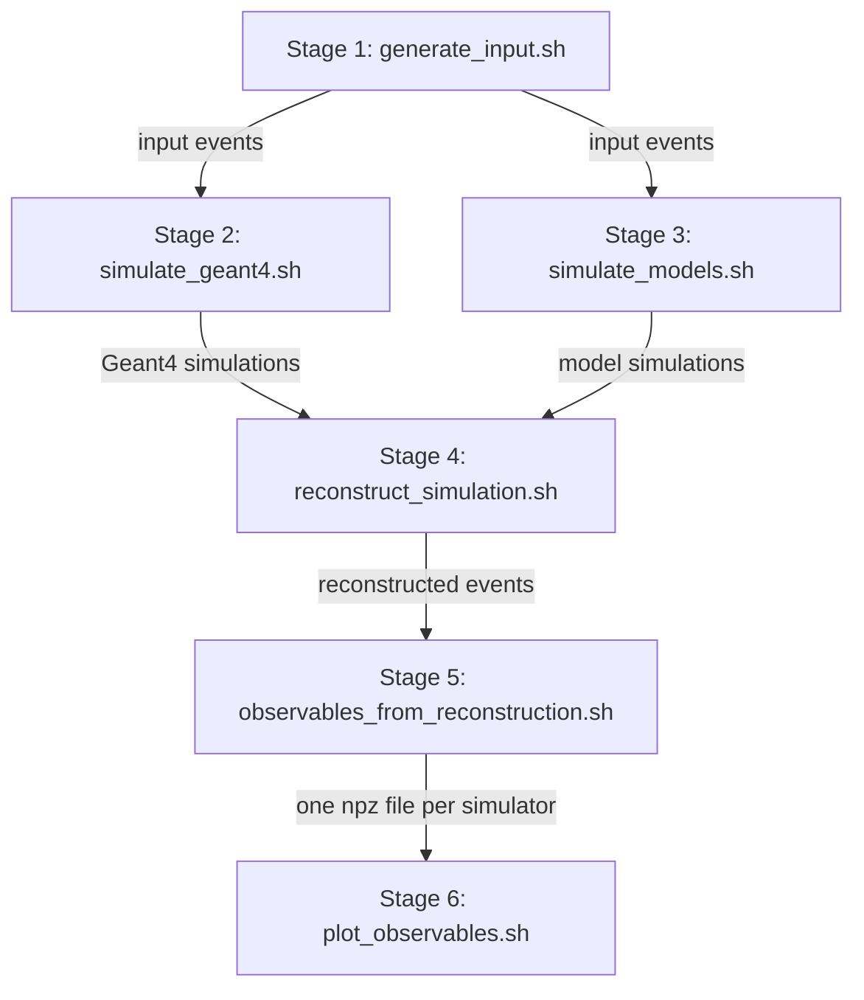

# FaSiNaTe

FaSiNaTe benchmarks generative fast-simulation models of calorimeter showers in a full detector chain.
Each model runs inside ILD's `ddsim` simulation through [DDML](https://github.com/key4hep/DDML), its events go through ILD's standard reconstruction, and observables measured on the reconstructed events are compared with full Geant4 simulation of the same inputs.

The benchmark follows the paper *"A First Full Physics Benchmark for Highly Granular Calorimeter Surrogates"*, starting with its single-photon shower profiles, energy linearity and resolution, and intrinsic shower angles, its di-photon separation, and the reconstructed π⁰s of its τ-pair physics benchmark. 
The models are those DDML runs: CaloClouds3, both through DDML's embedded Python and compiled against LibTorch, ConvL2LFlows, two BIB-AEs, a GAN (with LibTorch and with ONNX Runtime) and the Par04 example's VAE ([The models](#the-models)). Where a model runs through two of DDML's backends, the two are compared with each other as well, a [closure test](#closure-tests).

<p align="center">
  
  
</p>

*Example output of `plot_observables.sh` for the `single_photon` scenario (30 000 Geant4 events, 10–100 GeV): the mean reconstructed ECAL energy per layer (left) and against distance to the shower axis (right). Geant4 is the grey filled histogram, CaloClouds3 the orange line; the lower panels show the relative deviation from Geant4 with statistical uncertainties, and the legend gives the Jensen–Shannon divergence.*

## Contents

- [The pipeline](#the-pipeline)
- [Quick start](#quick-start)
- [The whole pipeline at once](#the-whole-pipeline-at-once)
- [Configuration](#configuration)
- [The environment](#the-environment)
- [Stage by stage](#stage-by-stage)
  - [1. Generate the inputs](#1-generate-the-inputs)
  - [2. Simulate with Geant4](#2-simulate-with-geant4)
  - [3. Simulate with the models](#3-simulate-with-the-models)
  - [4. Reconstruct](#4-reconstruct)
  - [5. Measure the observables](#5-measure-the-observables)
  - [6. Plot](#6-plot)
- [Where the data goes](#where-the-data-goes)
- [Reusing published measurements](#reusing-published-measurements)
- [The models](#the-models)
  - [Closure tests](#closure-tests)
- [Extending the benchmark](#extending-the-benchmark)
- [Tests](#tests)
- [Repository layout](#repository-layout)
- [Credits](#credits)

## The pipeline

Every stage is one script at the top of the repository. The scripts take their settings from the configuration, find the work left to do from what is already on disk, and skip what is finished, so any stage can be re-run safely after a failure or timeout. Behind them is one harness, [`ddml_bench/`](ddml_bench/) ([`docs/harness.md`](docs/harness.md)): a single module names every file, each stage declares its tasks, one per file, and the same task graph is run one task after another by `pipeline.sh` and the stage scripts, or as slurm jobs by `slurm_pipeline.sh`.



| Stage | Script | Reads | Writes (under `paths.data_dir`) |
|---|---|---|---|
| 1 | `generate_input.sh` | `scenarios` in the configuration | `input_single_particle_gun/*.slcio` (+ `.h5` truth); the physics samples, made elsewhere, are taken as they are from `input_physics_samples/` |
| 2 | `simulate_geant4.sh` | scenario inputs | `sim_output/<scenario>/geant4/*.edm4hep.root` |
| 3 | `simulate_models.sh` | scenario inputs, `models/*.yaml` | `sim_output/<scenario>/<model>/*.root` |
| 4 | `reconstruct_simulation.sh` | everything in `sim_output/` | `rec_output/<scenario>/<simulator>/*_REC.edm4hep.root` |
| 5 | `observables_from_reconstruction.sh` | finished reconstructions | `observables/<simulator>.npz` |
| 6 | `plot_observables.sh` | `observables/*.npz` | `observables/plots/*.{pdf,png}`, `dashboard.html`, `metrics.csv`, `fits.csv` |

Stages 2 and 3 are independent of each other; a "simulator" below means either Geant4 or one of the models. [`pipeline.sh`](#the-whole-pipeline-at-once) runs all six stages in one go, and on a slurm cluster [`slurm_pipeline.sh`](#the-whole-pipeline-at-once) runs them as jobs of one file each.

## Quick start

```bash
git clone https://github.com/HenryDayHall/FaSiNaTe.git
cd FaSiNaTe

# Say where software and (large) data should live
cat > configs/local.yaml <<'EOF'
paths:
  software_dir: /data/dust/user/$USER/fasinate/external
  data_dir: /data/dust/user/$USER/fasinate/data
EOF

./generate_input.sh                 # 1. inputs for every scenario
./simulate_geant4.sh                # 2. Geant4 (slow: on slurm, use slurm_pipeline.sh)
./simulate_models.sh                # 3. every model in models/
./reconstruct_simulation.sh         # 4. every simulation
./observables_from_reconstruction.sh  # 5. one .npz per simulator
./plot_observables.sh               # 6. figures and metrics.csv
```

or all six at once with `./pipeline.sh`, or `./slurm_pipeline.sh` on a slurm cluster. The first script to run builds DDML (and anything else the environment needs, see [below](#the-environment)), which takes a while; later runs reuse the build.

Before a full run, try the chain on a handful of events. Stages 2–6 take `-n N`: the simulation of the first N events of each input is named `<input>_n<N>`, and everything made from it carries that name on (`<input>_n<N>_REC.edm4hep.root`, `<simulator>_n<N>.npz`, `metrics_n<N>.csv`), so a test run never mixes with the full samples:

```bash
./simulate_geant4.sh -n 10
./simulate_models.sh -n 10
./reconstruct_simulation.sh -n 10
./observables_from_reconstruction.sh -n 10
./plot_observables.sh -n 10
```

Every script takes `--help`, and stages 1–5 also take `--dry-run`, showing what would be done and what is already done, `-f/--force` to make their outputs again, and `-c/--config FILE` to merge a configuration file over the others. Run them from the repository root (or set `FASINATE_REPO_DIR`). Apart from `slurm_pipeline.sh`, which submits its own jobs, the long-running ones can be submitted directly with `sbatch` from the repository root; their `#SBATCH` defaults are set for DESY's Maxwell cluster.

## The whole pipeline at once

`pipeline.sh` runs every stage here, one task after another, and `slurm_pipeline.sh` runs them on a slurm cluster. Both work out what each stage still has to do from what is on disk, as tasks of one file each, each waiting for the tasks that make what it reads; `slurm_pipeline.sh` submits each task as a job (`sbatch --dependency=afterok`):

| Stage | One task (job) for each | Waiting for |
|---|---|---|
| generate | input file still to make | |
| geant4 | input still to simulate with Geant4 | the task making its input |
| models | input and model still to simulate | the task making its input |
| reconstruct | simulation still to reconstruct | the task simulating it |
| observables | simulator whose measurements aren't up to date | the tasks reconstructing its simulations |
| plot | (one task) | the measurement tasks |

Try it first with [`configs/pipeline_test.yaml`](configs/pipeline_test.yaml), a very light test of every stage: two inputs of 10 photons each and one of 10 photon pairs, simulated with two seeds, in a data folder of its own, with short time limits. With the nine models in `models/`, that is 94 tasks (22 with CaloClouds3 alone).

```bash
./slurm_pipeline.sh --config configs/pipeline_test.yaml --dry-run  # what is done, and what would be submitted
./slurm_pipeline.sh --config configs/pipeline_test.yaml            # the test
./slurm_pipeline.sh                                                # the full benchmark
./pipeline.sh --config configs/pipeline_test.yaml                  # the test, here, one task after another
```

Run `slurm_pipeline.sh` on a login node, from the repository root. Before submitting anything it works out what is done and runs the stages' checks in the environment the jobs get (building DDML first if needed, which `--dry-run` does too), so that a missing model weight or compact file stops it there rather than failing every job. Like the stage scripts, both take simulators and `-s SCENARIO` to run only those, and `-n N` for a test on the first N events of each input; `-c/--config FILE` merges a configuration file over the others, for this run and all its jobs. `--stages` runs only some stages, `--force STAGE` makes a stage's outputs again and with them everything made from them, and for `slurm_pipeline.sh`, options after `--` go to every `sbatch` call:

```bash
./slurm_pipeline.sh caloclouds3               # this model's jobs, then the plots
./slurm_pipeline.sh --stages generate,geant4  # only the inputs and the Geant4 reference
./slurm_pipeline.sh --force reconstruct       # reconstruct everything again, and measure and plot it
./slurm_pipeline.sh -- --account=myproject    # more sbatch options
```

Either can be run again at any time. What is done is skipped, and whatever failed or timed out is run again. A task needing one that failed isn't run (a job waiting for one that fails is cancelled), so after a failure, fix what went wrong and run the script again. A task that a job of an earlier submission is still queued or running for is waited for, not submitted again. Adding a model to `models/` and running it again runs that model's tasks and the plots.

The simulations and reconstructions are only made for what is still to be made from them. One that isn't there isn't made while what it is for is done: a simulation whose reconstruction is there, or the simulations and reconstructions of a simulator whose measurements are up to date, as its `.npz` file records what it was measured from. So once a simulator is measured, its simulations and reconstructions can be deleted (to save space) without being made again, and measurements fetched along with the inputs need no simulation at all ([Reusing published measurements](#reusing-published-measurements)). The stage scripts work the same way; `--dry-run` reports such tasks as `not needed`, and `--force` (`-f`) makes them anyway.

Each submission of `slurm_pipeline.sh` gets a folder, `slurm/pipeline_<time>/` in `paths.data_dir`, with the job script, the jobs submitted (`jobs.tsv`), what was done and why (`tasks.json`) and each job's slurm log in `logs/`. Every job runs one task of `tasks.json`, `scripts/ddml-bench run-task`, in the environment from `setup.sh`; the tasks write their logs next to their outputs, as the stage scripts do. The partition, constraint, time limit and other `sbatch` options of each stage's jobs are in the `slurm` section of the configuration.

## Configuration

Shared settings live in [`configs/default.yaml`](configs/default.yaml):

- `paths`: where external software is built (`software_dir`), where all inputs and outputs go (`data_dir`), and where the steering file finds model weights (`model_dir`);
- `ddml`, `key4hep`, `container`, `detector_configs`, `patches`: the software stack (see [The environment](#the-environment));
- `geant4`, `reconstruction`: settings for the reference simulation and the reconstruction;
- `scenarios`: the sets of events every simulator simulates (one with `enabled: false` is left out of every run);
- `observables`: what is measured on them, and how it is compared with Geant4;
- `published`: the published data (Zenodo records) a run fetches instead of making it ([Reusing published measurements](#reusing-published-measurements));
- `slurm`: the jobs of [`slurm_pipeline.sh`](#the-whole-pipeline-on-slurm), stage by stage.

Don't edit `default.yaml` for your own setup. Put the settings you change in `configs/local.yaml`, which git ignores and every script reads automatically. An override file only needs the keys it changes, e.g. a smaller single-photon sample for testing:

```yaml
scenarios:
  single_photon:
    input:
      n_events: 100
```

(Input file names don't include the number of events, so this replaces the full samples; use `-n` instead to test without touching them, or a data folder of its own, as [`configs/pipeline_test.yaml`](configs/pipeline_test.yaml) does.)

Values can refer to other settings (`${paths.software_dir}`) and to environment variables (`$USER`); relative paths are relative to the repository. More override files can be layered on top by listing them in `FASINATE_CONFIG`. Inspect the merged result with

```bash
python3 scripts/fasinate_config.py                      # everything
python3 scripts/fasinate_config.py --get paths.data_dir  # one setting
```

This needs Python 3 with PyYAML (`python3 -m pip install --user pyyaml`).

Each model has its own file in [`models/`](models/); see [Adding a model](#adding-a-model).

## The environment

Every stage runs in the same environment: a Key4hep release, a build of DDML's `python-inference` branch against it, ILDConfig for the reconstruction, and any patches the release still needs. You don't normally have to set this up yourself: each script builds what is missing, then runs its work in a clean shell inside an Apptainer/Singularity container (`container.image`, AlmaLinux 9 by default) with `/cvmfs` mounted. Set `container.enabled: false` to run directly on a host with a matching OS and `/cvmfs`, e.g. in CI. One launcher does this for every script, `scripts/run_in_environment.sh`, with the clean shell and the container set up by `scripts/environment.sh`, which the build scripts use too.

For interactive work, get the same environment in a clean bash shell with

```bash
source setup.sh
```

Source it only once per shell, as the Key4hep setup can only run once. In a shell that has sourced it, the stage scripts run in place rather than starting a container.

What it sets up, and the scripts that do it:

- **DDML** — `scripts/build_ddml.sh` clones DDML into `ddml.source_dir` (at `ddml.commit` if set, otherwise the head of `ddml.branch`), pulls the container image if needed, builds DDML inside it against `key4hep.release`, and writes `ddml.env_file`. Building also downloads DDML's reference models into DDML's `models/` folder, and then those of `ddml.extra_models`, which DDML's build leaves out ([`scripts/fetch_ddml_models.py`](scripts/fetch_ddml_models.py)). It rebuilds only when the DDML commit or branch, the build options, the Key4hep release or the image change. Run it by hand to move to the head of the branch (`--dry-run`, `--clean`, `--config FILE` and `--set section.key=value` are available); it prints the commit and release used, ready to pin in `configs/local.yaml`.
- **ILDConfig** — Key4hep releases don't include it, so `scripts/fetch_detector_configs.sh` clones it to `detector_configs.ildconfig.source_dir`. Pin `detector_configs.ildconfig.commit` for benchmark runs.
- **Patches** — fixes that are upstream but not yet in a Key4hep release, built by `scripts/build_patches.sh` (see [Patches to the Key4hep release](#patches-to-the-key4hep-release)).

For benchmark runs, pin `ddml.commit`, `key4hep.release` and `detector_configs.ildconfig.commit` so results are reproducible.

### Patches to the Key4hep release

Each entry under `patches` rebuilds one package of the release from a newer version and swaps its library into `MARLIN_DLL`. There is one so far:

- `marlintrkprocessors`: up to version 2.12.8, ILD's TPC digitisation (`DDTPCDigiProcessor`) aborts the whole job with `padTheta = nan` on some hit triplets, which backscatter from Geant4 showers can produce. The fix, [iLCSoft/MarlinTrkProcessors#79](https://github.com/iLCSoft/MarlinTrkProcessors/commit/f2da912fa583eb6da3e9aac4c8ba43fcde64efab), is in `v02-12-09`, which is what gets built.

A patch is only used while the release's own version is older than its `fixed_in`. Once DDML is built against a release that has the fix, `setup.sh` stops using it and says the entry can be deleted from `configs/default.yaml`. To run without a patch before then, set `patches.<name>.enabled: false` in `configs/local.yaml`. The patches in use are printed by `setup.sh` and recorded in each reconstruction log.

## Stage by stage

### 1. Generate the inputs

```bash
./generate_input.sh                # every scenario
./generate_input.sh single_photon  # just this one
```

Each scenario's `input` section says how its events are made. The `particle_gun` type runs [`ILD_Particle_Gun.py`](ILD_Particle_Gun.py) once per energy, with the remaining keys passed as its options; the i-th energy uses `seed + i`, so the samples are independent. Each energy gives an `.slcio` file of starting particles and an `.h5` file of the true energies, momenta and gun positions, in `input_single_particle_gun/`. Each is made in a hidden folder and moved into place when complete; inputs that exist are skipped, unless `-f` is given.

The default `single_photon` scenario fires photons from the IP into one stave of the ECAL barrel, at 10, 20, …, 100 GeV with 3000 events each, spread uniformly over the front face of the stave.

The `di_photon_gun` type runs [`ILD_Di_Photon_Gun.py`](ILD_Di_Photon_Gun.py) in the same way. The default `di_photon` scenario makes pairs of photons of the same energy, 20 and 100 GeV with 15 000 pairs each, both starting on the front face of the ECAL barrel's top stave and flying from the IP. They are placed as in the earlier di-photon analysis: the pair's midpoint uniform over a disc of 10 mm (`centre_radius`) about x = 0, z = 70 mm (`centre_x`, `centre_z`), the separation uniform from 0 to 90 mm (`max_separation`), and the line between the two photons at a random angle. Its `.h5` file holds both photons' momenta and starting points, and their separation. The paper's 5 GeV set needs a model trigger below 10 GeV, which CaloClouds3's preset doesn't have yet, so it is left out for now.

Each scenario's inputs go in the folder its `input.folder` names, under `paths.data_dir`: `input_single_particle_gun` for the guns, unless it says otherwise.

The `external` type is for inputs that can't be made in this repository, such as the physics samples of ILD's MC production. `input.files` names the files (LCIO, `.slcio`) in the scenario's folder, by default `input_physics_samples`, and nothing makes them: an input that is there is used as it is (`generate_input.sh -f` leaves it alone), and one that isn't is fetched from a published record that has it ([Reusing published measurements](#reusing-published-measurements)). A scenario runs with all of its inputs or not at all: without them, a run leaves it out, and the observables measured on it alone, says which files to put where, and runs everything else as usual (exiting 0). Asking for it by name (`-s`, `--file`) is then an error. The default `tau_pairs` scenario is the paper's τ physics dataset: e⁺e⁻ → τ⁺τ⁻ at 250 GeV from ILD's MC-2020 production, in three files of 6791 events, kept for having a π⁰ from a τ decay with both photons above 5 GeV in the models' trigger region:

```
<data_dir>/input_physics_samples/gen_tau_pi0_250-SetA_2f_leptonic_eL_pR_42.slcio
<data_dir>/input_physics_samples/gen_tau_pi0_250-SetA_2f_leptonic_eL_pR_1764.slcio
<data_dir>/input_physics_samples/gen_tau_pi0_250-SetA_2f_leptonic_eL_pR_74088.slcio
```

These aren't published yet, so put them there by hand to run it. Its events are a generator's, so their reconstruction isn't told they are a particle gun's, and they reach the whole detector: the models simulate the photons their presets trigger on, and Geant4 everything else.

### 2. Simulate with Geant4

Full Geant4 is the reference the models are compared with. `simulate_geant4.sh` runs `ddsim` with DDML's steering file but without DDML's fast simulation ([`scripts/ddsim_steer_geant4.py`](scripts/ddsim_steer_geant4.py)), so every other setting (physics list, crossing angle, filters, …) matches the model simulations, in the detector `geant4.compact`.

```bash
./simulate_geant4.sh --dry-run                    # what's left to do
./simulate_geant4.sh -s single_photon             # one scenario, all inputs in sequence
./simulate_geant4.sh --file <input>.slcio         # a single input
```

Geant4 is slow, so on a slurm cluster use `slurm_pipeline.sh --stages geant4`, which submits one job per input (`slurm_simulate_geant4.sh` now runs just that):

```bash
./slurm_pipeline.sh --stages geant4                         # one job per input still to simulate
./slurm_pipeline.sh --stages geant4 -- --time 3-00:00:00    # options after -- go to sbatch
```

### 3. Simulate with the models

`simulate_models.sh` simulates every scenario's inputs with every model in `models/` (or those named), running `ddsim` as in DDML's README, with DDML's steering file. A model with DDML presets (`ddml.presets`) runs with them (`--ml-model`). One that DDML has no preset for has its DDML model configurations written out in its description (`ddml.model_configs`, see [Adding a model](#adding-a-model)), and runs [`scripts/ddsim_steer_models.py`](scripts/ddsim_steer_models.py) instead, with each configuration as an option `--ml-config '<JSON>'`: it runs DDML's steering file with DDML's own Python package, but with the configurations made from those options in place of presets, so every other setting is the same as for a preset, and it prints the configurations it made into the log. It also puts `models/` first on ddsim's Python path, for a model with [inference code of its own](#a-models-own-inference-code). The log of each model's simulation starts with the sha256 of the model's description and of its own Python code as `ddsim` started.

```bash
./simulate_models.sh --dry-run
./simulate_models.sh                              # every model, every scenario
./simulate_models.sh -s single_photon caloclouds3 # one scenario, one model
```

Before simulating, it checks that the DDML libraries, the `ddml` Python package and the plugin of each preset or configuration come from the configured build, that each gives DDML the particles the model is for, that each model's weights match their recorded md5 sum, that the weights each plugin loads (its `ModelPath`) are those weights, and that the Python module each embedded-Python plugin runs is there (and says where: in `models/`, or DDML's). Each model is simulated in the detector it was trained for (`fixed_at_training.detector.compact_file`).

Both simulation scripts accept `-i FILE` to simulate an arbitrary input file (written under the scenario name `custom`), `--file FILE` to simulate just that one of the scenarios' inputs, and `-f/--force` to redo existing outputs (and make those that [nothing needs](#the-whole-pipeline-at-once), e.g. for measurements that are up to date). `ddsim` writes to a hidden file that is renamed only on success, so an output that exists is always complete. An input that isn't made yet is an error, unless nothing needs its simulation.

A scenario with `simulation_seeds` (`di_photon` has `[1, 2, 3]`) has each of its inputs simulated once with each seed, passed to `ddsim` as `--random.seed`, each a task of its own named `<input>_simseed<S>`, so that the plots can take the spread over the seeds. With `one_seed_per_input: true`, each input is simulated once instead, with the seed in the same place in the list (one for each input, in order): `tau_pairs` simulates each of its three files with the seed it is named after, as `ddsim --random.seed=42` for `..._42.slcio`. Otherwise `ddsim` chooses the seed, and writes it in its log.

### 4. Reconstruct

The simulations are reconstructed with ILD's standard reconstruction under Gaudi: ILDConfig's `ILDReconstruction.py` run with `k4run`, as in the Key4hep tutorial [ILD Simulation and Reconstruction with Key4hep](https://key4hep.github.io/key4hep-doc/main/tutorials/key4hep-tutorials/gaudi_ild_reco/README.html).

```bash
./reconstruct_simulation.sh --dry-run
./reconstruct_simulation.sh                         # every finished simulation
./reconstruct_simulation.sh -s single_photon geant4 # one scenario, one simulator
./reconstruct_simulation.sh path/to/sim.root        # one file
```

It reconstructs the simulations of the scenarios' inputs, by Geant4 and by every model, each in the detector it was simulated in (`--compact FILE` overrides this). Each `<name>.root` becomes `<name>_REC.edm4hep.root`, alongside `<name>_AIDA.root`, `<name>_PfoAnalysis.root` and the log. With `-n N` it reconstructs the simulations of the first N events, `<input>_n<N>`, whole; simulation files can also be given directly, and `-s custom` reconstructs what was simulated with `-i`. `--noBeamCalReco` is always passed, and `--usingParticleGun` for particle-gun scenarios (not for the physics samples); further arguments for `ILDReconstruction.py` go in `reconstruction.extra_args` (e.g. `[--lcioOutput, "on"]` to also write LCIO). As with simulation, outputs appear only once complete, and existing ones, and those nothing needs, are skipped unless `--force` is given (a simulation file given is reconstructed even if nothing needs it).

### 5. Measure the observables

`observables_from_reconstruction.sh` measures every observable in the configuration for each simulator whose reconstruction is finished, i.e. every input of every scenario the observables use has its `_REC.edm4hep.root`.

```bash
./observables_from_reconstruction.sh --dry-run
./observables_from_reconstruction.sh                 # every finished simulator
./observables_from_reconstruction.sh caloclouds3 geant4
```

The current observables are the shower profiles, the energy response and the intrinsic shower angles from the benchmark paper, measured in the `single_photon` scenario, the profiles and the angles on reconstructed ECAL barrel hits and the energy on reconstructed particles; the di-photon separation, measured in the `di_photon` scenario; and the reconstructed π⁰s, measured in the `tau_pairs` scenario:

- `radial_profile`: mean hit energy per unit area (GeV/mm²) against the distance from the incident photon's line of flight to the hit's cell centre, i.e. the energy in each ring around the line of flight divided by the ring's area, π(r<sub>out</sub>² − r<sub>in</sub>²), so that the rings growing with the radius don't skew it; once out to 100 mm (50 bins) and once out to 30 mm (30 bins) to resolve the core;
- `longitudinal_profile`: mean hit energy per ECAL layer, decoded from the hits' cellIDs;
- `energy`: the reconstructed energy of each event, the sum of the energies of its reconstructed particles (`particle_collections`, PandoraPFA's `PandoraPFOs`; set `pdg`, e.g. `[22]`, to count only those PDG codes), with the incident photon's true energy, from which the plots take the energy linearity and resolution;
- `intrinsic_angle`: the residuals, reconstructed − true, of the polar angle θ and the azimuth φ of each shower's axis (the paper's iTheta and iPhi). The axis is the first principal component of an energy-weighted principal component analysis (PCA) of the shower's reconstructed hits: the direction in which they spread the most about their centre, both weighted by the hits' energies, taken along the photon's direction, since an axis has no sign of its own. Only the hits in a bounding box about the shower go into it: a cube with sides of `bounding_box` mm (800 in the default configuration; `null` for every hit), centred on the photon's vertex, where the particle gun starts it on the ECAL's front face, its edges along the global axes (those of the top stave). Like the 800 mm box of the paper's optimal shower generators, it leaves out hits far from the shower, such as those of backscatter reaching the other side of the detector, which the models don't make and which can tilt the axis of all the hits a long way. A shower with none of its hits in the box has no axis, and the measurement warns of it. There is one PCA for each fraction in `hit_fractions` of the hits in the box, the most energetic first: all of them, and the top 4% (rounded up, at least 2 hits), which leaves out the peripheral hits, e.g. from backscatter, that tilt the axis. Angles are in degrees in the global frame, θ from the beam axis and φ = atan2(y, x), with Δφ wrapped to ±180°.
- `photon_separation`: for each event of two incident photons, their separation on the front face of the ECAL barrel, from the MC truth of the reconstructed event (`MCParticles`, its two particles of generator status 1): the distance between the points where their lines of flight cross the plane of the stave they head into, `surface_distance` (1804.7 mm in ILD_l5_o1_v02) from the beam axis, of the `barrel_symmetry` (8) staves. The guns' photons start on the face, so they cross it where they start. With it go the mean of the two photons' energies and the number of the event's reconstructed photons, the reconstructed particles in `particle_collections` (`PandoraPFOs`) of the PDG codes in `pdg` (`[22]`).
- `pi0`: the π⁰ candidates of ILD's reconstruction (`candidate_collection`, `GammaGammaCandidatePi0s`: pairs of PandoraPFA's photons, `particle_collection`, fitted with the π⁰'s mass as a constraint), each matched to the MC truth through its two photons, as the paper's τ benchmark does. A photon is correct when its reconstructed particle and a photon of an MC π⁰ are each other's best match, by the highest weight of the links each way (`link_collection`, `RecoMCTruthLink`, weighted by each MC particle's share of a reconstructed particle's energy, and `reverse_link_collection`, `MCTruthRecoLink`, by the share of an MC particle's energy in each reconstructed particle; `null` uses the first alone). A candidate is good when both its photons are correct and those of one MC π⁰ (the paper's nGood), confused when only one is, and fake otherwise. The MC π⁰s are those of the generator decaying into two photons with a τ among their ancestors (`ancestor_pdg`, `[15]`). Of every candidate it keeps the invariant mass of its two photons, M = √(2E₁E₂(1 − cos θ₁₂)) (the candidate's own mass is the π⁰'s, which the fit imposes), its fitted energy, the sum of its photons' energies, its θ and φ, its match, and the energy, θ and φ of its MC π⁰; of every event the number of candidates and of MC π⁰s. That is enough for the paper's other π⁰ figures too (the reconstruction categories and the angles) without measuring again.

For each simulator it writes `observables/<simulator>.npz`, holding every profile per input file as sums over events of each bin's energy and squared energy, plus the event count and the `ddsim` seed of each file. From these the mean per event and its statistical uncertainty follow, for all energies combined or each separately. The energy, the angles' residuals and the separation are kept per event, and the π⁰ candidates one by one, since the central 90% the plots take needs every event and the residuals, separations and π⁰s can then be binned anew ([`ddml_bench/measure.py`](ddml_bench/measure.py) documents the keys). The reconstructed files are recorded relative to `paths.data_dir`, so the files stay valid when copied elsewhere. A simulator is skipped if its file already has every requested key, computed with the same settings from the same files, by what the file records: the reconstructed files needn't still be there, though any that are mustn't be newer. Adding an observable, or changing its settings, measures every simulator again: only this stage while their reconstructions are there, but a simulator whose reconstructions are gone (or never were, as for measurements fetched elsewhere) is simulated and reconstructed again first.

The cellID encoding is read from the reconstructed file, or failing that from the detector geometry; set `observables.longitudinal_profile.cell_id_encoding` to give it by hand. A warning is printed if more than 1% of a file's hits fall outside layers 0 to `max_layer`, which usually means the encoding is wrong.

### 6. Plot

```bash
./plot_observables.sh                                     # everything found, to observables/plots/
./plot_observables.sh caloclouds3                         # just this model against Geant4
./plot_observables.sh -d copied/observables -o figures    # e.g. on a laptop, from copied .npz files
./plot_observables.sh --format pdf                        # default is pdf,png
./plot_observables.sh --no-dashboard                      # without dashboard.html
```

Each figure, `<observable>_<profile>__<scenario>.<format>` (e.g. `radial_profile_r30__single_photon.png`, shown [at the top](#fasinate)), puts every simulator on the same axes: Geant4 as a grey filled histogram, each model as a line with its uncertainty band, and each model's relative deviation from Geant4 underneath. The legend gives each model's distance from Geant4 using the observable's `metric` (the Jensen–Shannon divergence for the profiles), and all metrics are collected in `metrics.csv`, with an `uncertainty` column for those that have one. The `.npz` files hold the energy per ring of the radial profiles, which is divided by the rings' areas only when drawn; the metric compares the fractions of the energy in the bins, and the relative deviations are ratios, so neither depends on that division.

The `energy` gives two figures, as in the paper. At each true energy *E*, μ<sub>90</sub> and σ<sub>90</sub> are the mean and standard deviation of the central 90% of the events' reconstructed energies (sorted, without the lowest and highest 5%), with uncertainties from resampling the events (200 bootstrap resamplings, the same every time):

- `energy_linearity__<scenario>`: μ<sub>90</sub> against *E*, fitted with a straight line, slope·*E* + intercept;
- `energy_resolution__<scenario>`: σ<sub>90</sub>/μ<sub>90</sub> against *E*, fitted with *a* + *b*/√*E* + *c*/*E*.

Each simulator is a set of points with its fit (weighted least squares), Geant4 in grey, and the legend gives each fitted function; below, each model's relative deviation from Geant4. The metric, `l1` by default, is the mean absolute difference from Geant4 over the energies, like the L1 of the paper's summary table. The fitted parameters, with their uncertainties, χ² and degrees of freedom, go to `fits.csv`. A fit needs at least as many energies as it has parameters, so a run of two energies, such as [`configs/pipeline_test.yaml`](configs/pipeline_test.yaml), draws the resolution without its fit. The inputs must be at fixed energies (the particle gun's `energies`), with at least 3 events at each.

The `intrinsic_angle` gives a figure for each angle and each PCA, `intrinsic_angle_<angle>_<hits>__<scenario>` with `<hits>` `all` or `top4` (e.g. `intrinsic_angle_theta_top4__single_photon`), as in the paper's two angle figures: the distribution of the residuals as the fraction of the showers per degree, drawn like the profiles, with Geant4 filled, the models as lines and the relative deviations below. The metric is the Jensen–Shannon divergence of the fractions in the bins, as in the paper's summary table. The bins go from −`max_residual` to `max_residual` degrees, `n_bins` of them (5° and 100 by default; each is one number for every PCA, or a list with one for each fraction in `hit_fractions`, in the same order, e.g. `max_residual: [10, 3]` for ±10° with all the hits and ±3° with the top 4%). They only affect the figures, so after changing them only `plot_observables.sh` needs to run again, not the measurements. Showers outside the bins still count towards the total, and the share of them is noted on the figure, which also says the side of the bounding box the hits were taken from, as Geant4's measurements record it (the plots warn if the simulators' boxes differ). Showers whose PCA has no axis (fewer than two hits in the box) are left out.

The `photon_separation` gives a figure for each energy of the photons, `photon_separation_<E>GeV__<scenario>` (e.g. `photon_separation_20GeV__di_photon`), as in the paper's di-photon figure: the mean number of reconstructed photons per event in bins of the separation, drawn like the profiles, with a red line at two photons. Each simulator's curve is the mean over the seeds of each seed's mean, and its band the spread over the seeds, their sample standard deviation (with one seed, the statistical uncertainty instead). The metric, by default the Jensen–Shannon divergence, compares the number of reconstructed photons in each bin, seed by seed, Geant4's seeds and the model's paired in order; the legend and `metrics.csv` give the mean over the seeds, with their standard deviation as its uncertainty. The bins go from 0 to `max_separation` mm, `n_bins` of them (90 mm and 18 by default); like the residuals' bins, they only affect the figures. Events without two incident photons heading into the face are left out.


The `pi0` gives the two figures of the paper's figure 11, of the good π⁰s: `pi0_mass__<scenario>`, the invariant mass of their two photons, and `pi0_energy__<scenario>`, their reconstructed energy less their MC π⁰'s, E<sub>π⁰</sub><sup>reco</sup> − E<sub>π⁰</sub><sup>MC</sup>, the reconstructed energy being the candidate's fitted one (`reconstructed_energy: fitted`) or the sum of its photons' (`photons`). Each is drawn as the fraction of the good π⁰s per GeV, like the profiles, each simulator's curve the mean over the seeds and its band their spread, with the relative deviations from Geant4 below. The metric, by default the Jensen–Shannon divergence, compares the numbers of good π⁰s in the bins seed by seed, as for the separation, giving the mean with the spread over the seeds as its uncertainty (the paper's JS of M<sub>π⁰</sub> and E<sub>π⁰</sub>). The bins (`mass_range` and `mass_bins`, by default 0.09–0.18 GeV in 18; `energy_range` and `energy_bins`, −6 to 6 GeV in 48) and `reconstructed_energy` only affect the figures.

A model that is the [closure test](#closure-tests) of another is also drawn against that one alone, as the reference, in `closure/<model>/`, with the metrics between the two there, and `closure.csv` says for each scenario whether the two measured the same. `--no-closure` leaves these out, and `--reference NAME` compares everything with another simulator than Geant4.

Plotting only needs numpy and matplotlib: it uses your own `python3` if it has them, and the `setup.sh` environment otherwise, so the `.npz` files can be copied elsewhere and plotted there.

#### The dashboard

Every run of the plots also writes `dashboard.html` (`dashboard_n<N>.html` for the first *N* events): every figure, the closure tests' too, in one page with a menu of the models. Untick a model to hide it in every figure, or click its entry in a figure's legend to hide or show it in that figure alone (the figure's *Reset* puts it back as the menu has it); *only* next to a model shows it alone. The menu also picks a scenario or an observable, and how many figures go in a row. Geant4, as the reference, is always shown. The figures are the same as the PNG and PDF files, so the axes stay as drawn with every model: hiding one doesn't zoom in on the others. Opened on its own, the page keeps what it hides in its address (`dashboard.html#hide=par04_vae_onnx&scenario=single_photon`), to come back to or to send.

The page is a single file with nothing to fetch, so it works wherever it is opened:

- **In a notebook** on Maxwell's JupyterHub (as in [`Display_outputs.ipynb`](Display_outputs.ipynb)):

  ```python
  from ddml_bench.dashboard import show
  show()              # the plots in paths.data_dir; show(events=3) for dashboard_n3.html
  ```

  The menu works in the output of a cell you ran; after opening the notebook again, run the cell again.
- **From JupyterHub's file browser**: open `dashboard.html`, then click *Trust HTML* in the viewer's toolbar.
- **Through ssh**, in your own browser: on Maxwell, `python3 -m http.server 8765 --bind 127.0.0.1` in the plots folder; on your computer, `ssh -L 8765:localhost:8765 <the same login node>`, then open `http://localhost:8765/dashboard.html`.
- **Copied**: `scp` it anywhere and open it; it needs nothing else.
- **As a GitHub artifact**: upload it on its own with `actions/upload-artifact@v7` and `archive: false`, and it opens in the browser from the run's page (the CI uploads the dashboard of its pipeline test this way).

The page is made from SVG copies of the figures, in which each model's curves, bands, points, fits and legend entry are marked with its name ([`ddml_bench/dashboard.py`](ddml_bench/dashboard.py)); `--format svg` keeps those copies too. With ten simulators it takes about 70 kB per figure.

## Where the data goes

Everything is written under `paths.data_dir`:

```
<data_dir>/
├── input_single_particle_gun/     # stage 1: <input>.slcio + <input>.h5
├── input_physics_samples/         # the physics samples' <input>.slcio, made elsewhere
├── sim_output/
│   └── <scenario>/
│       ├── geant4/                # stage 2: <input>.edm4hep.root + log
│       └── <model>/               # stage 3: <input>.root + log
├── rec_output/
│   └── <scenario>/<simulator>/    # stage 4: <input>_REC.edm4hep.root, _AIDA.root, _PfoAnalysis.root, .log
├── observables/
│   ├── <simulator>.npz            # stage 5
│   └── plots/                     # stage 6: figures, dashboard.html, metrics.csv and fits.csv
└── slurm/
    └── pipeline_<time>/           # submissions of slurm_pipeline.sh (slurm.log_dir)
```

One module, [`ddml_bench/layout.py`](ddml_bench/layout.py), names all of these; each scenario's inputs are in the folder its `input.folder` names. Test runs with `-n N` add `_n<N>` to every file name after the inputs, the simulations of a scenario's `simulation_seeds` add `_simseed<S>` after that, and files simulated with `-i` go under the scenario `custom` (reconstructions of files outside `sim_output` go to `rec_output/custom/files/`).

## Reusing published measurements

The benchmark's inputs and the measurements of Geant4 and CaloClouds3 are published on Zenodo: [FaSiNaTe essential data](https://doi.org/10.5281/zenodo.23670827), version 0.1.0, with its manifest. Every run fetches from it what it would otherwise make, so a model can be compared with them without running anything of theirs again. (Version 0.1.0's measurements were made before the intrinsic angle had a bounding box, so a run fetches them only with `bounding_box: null` under `observables.intrinsic_angle` in `configs/local.yaml`; otherwise it makes the references' measurements itself, simulating and reconstructing them first.) In a fresh data folder:

```bash
./pipeline.sh --dry-run    # would fetch the 12 inputs and 2 measurements, and make the plots
./pipeline.sh              # fetches them, then plots
# add your model to models/, then
./slurm_pipeline.sh        # simulates, reconstructs and measures only your model, and plots
```

Before working out what is to do, a run reads the manifests of the records in the configuration's `published` section and fetches into the data folder each published file that isn't there yet and is what the run would make:

- an input, when its gun options are this configuration's (the inputs' names don't say everything, e.g. the number of events), so the new model simulates the same events as the references; an input made elsewhere (`external`) when it is the published file of its name in its folder, even with `--force generate`, as it can't be made here;
- a simulator's measurements, `observables/<simulator>.npz`, when they are what the observables stage would make: the same observables with the same settings, measured on the same scenarios' reconstructions, by a simulator of this configuration (a model with the same presets or configurations and detector, and, where the manifest records them, the same weights, description and own Python code, by their sha256: a change to a model's description other than to its comments, label or plot style makes it another model), from inputs that are the published ones (fetched, or here already and the same by sha256).

Each file is checked against the sha256 and size in the manifest before it is put in place, and the manifest against the md5 sum Zenodo gives it, pinned in the configuration. Nothing that is there is replaced, a forced stage (`--force`) fetches nothing, and a run says why a published file isn't used, e.g. after changing an observable's settings. Measurements that are up to date need no simulation or reconstruction, so those of the references aren't made (`not needed` in the report). `slurm_pipeline.sh` fetches on the login node, before submitting, so the jobs need no internet. `--no-fetch` (or `published.enabled: false`) makes a run make everything itself, and a record that can't be read stops the run, rather than quietly making everything (hundreds of GB for the references).

The inputs are chosen first and the measurements then, for the scenarios that will run: a scenario whose inputs made elsewhere are neither here nor published is left out, and so are its observables, so the published measurements made without it are still fetched. Once its inputs are there, every simulator is measured again with it, and measuring a simulator needs its reconstructions of every scenario: one whose measurements were fetched is then simulated and reconstructed again for the other scenarios too, until published measurements include the new scenario.

The configuration should be the one the published data was made with: its `scenarios` and `observables`, and to compare like with like the software, `key4hep.release`, `ddml.commit` and `detector_configs.ildconfig.commit`; a run that fetches measurements says which of these differ from what made them. A new version of a record is used once its id (and its manifest's md5) replaces the old one in `published.records`.

The simulations and reconstructions are needed only to measure those simulators again: adding an observable, or changing the settings of one, simulates them again. What the published measurements don't cover:

- the test samples (`-n N`), whose measurements are files of their own, `<simulator>_n<N>.npz` (their inputs are fetched all the same);
- the step timings of [`scripts/plot_step_times.py`](scripts/plot_step_times.py), which come from the logs next to the simulations and reconstructions and from the slurm logs (and compare only between runs on the same machines).

### Publishing a data folder

`ddml-bench manifest` prepares a data folder for publishing as several records:

- `essential`: everything the pipeline needs to add a model, the `.slcio` inputs (of every scenario's folder) and the full samples' `.npz` measurements, all `required`;
- `input_truth__<scenario>`: the guns' `.h5` truth of each scenario's inputs, `optional` (no stage reads it);
- `sim_output__<scenario>__<simulator>` and `rec_output__<scenario>__<simulator>`: the simulations and reconstructions, with their logs, file by file, never fetched automatically (`archive`). Where they are more than a record takes (`--max-record-gb`, 50 by default, Zenodo's quota without asking, and 99 files) they are split into `__part1`, `__part2`, ..., each simulation's or reconstruction's files together;
- `other`: the rest, small, as a tar archive per folder (`observables.tar`: the plots and test samples' `.npz` files; `slurm.tar`: the submissions and their slurm logs), members named by their paths in the data folder.

```bash
python3 scripts/ddml-bench manifest --dry-run                     # the records, and what goes in each
python3 scripts/ddml-bench manifest --out /path/to/zenodo --stage
python3 scripts/ddml-bench manifest --out /path/to/zenodo --stage --records 'essential,input_truth__*'
```

Each record gets a folder with its `manifest.json` and a suggested title, and with `--stage` the files to upload under the flat names the manifest gives them: links to the data folder's files (`--copy` to copy them), so nothing big is copied, and the `other` record's archives. For every file the manifest has its path in the data folder, sha256, size and role. For an input it adds the scenarios and gun options that made it, or `external: true` for one made elsewhere. For a measurement it adds the simulator, scenarios and observable settings, the reconstructions it was measured from with their seeds and events, the inputs behind them with their sha256, the software from the logs of their simulations and reconstructions (Key4hep release, DDML and ILDConfig commits, patches, detector, presets or model configurations, the sha256 of a model's description and of its own Python code as each simulation started, reconstruction arguments), a model's description as it is now (`model`: presets or configurations, detector, weights with their md5 sum, and the sha256 of the description and of each module of its own Python code), and whether it is up to date with this configuration. Every manifest also has the configuration's scenarios, observables and stack pins, and the essential record's lists every record (`catalogue`), so that it says where everything else is. Warnings point out inputs missing from the configuration, measurements out of date, logs that aren't there, mixed software versions, and records over the limits. Hashing reads every file once, which takes a while for the simulations; `--records` makes some records at a time. It needs numpy (and PyYAML for the configuration), so it runs on a login node.

## The models

Each model in [`models/`](models/) runs through DDML in the ECal barrel, as DDML's presets do: photons above 10 GeV entering the barrel go to the model, and Geant4 simulates everything else. They are DDML's generative models, each with DDML's own weights, which building DDML downloads (and `L2LFlowsx9.pt`, which DDML's build leaves out, `scripts/build_ddml.sh` fetches as DDML would, by its md5 sum: `ddml.extra_models`):

| Model | What it is | How DDML runs it | Backend | Weights |
|---|---|---|---|---|
| `caloclouds3` | CaloClouds3, a point-cloud model | preset `CC3_BARREL_PY_INTERFACE` | embedded Python | `CC3_SF_2A.pt` |
| `caloclouds3_libtorch` | the same, compiled: `caloclouds3`'s closure test | preset `CC3_BARREL`, with `caloclouds3`'s weights | LibTorch | `CC3_SF_2A.pt` |
| `caloclouds3_paper` | CaloClouds3, the checkpoint of the CaloClouds3 paper | preset `CC3_BARREL` | LibTorch | `CC3_paper_checkpoint.pt` |
| `caloclouds3_rescaled` | the same checkpoint, with the energy of every point multiplied by its description's `energy_rescale` | its configuration: preset `CC3_BARREL_PY_INTERFACE`, running [its own code](#a-models-own-inference-code), `models/caloclouds3_rescaled.py` | embedded Python | `CC3_paper_checkpoint.pt` |
| `l2lflows` | ConvL2LFlows, a layer-to-layer normalising flow on a grid three times finer than the cells | its configuration | LibTorch | `L2LFlowsx9.pt` |
| `bibae_two_angle` | a BIB-AE on a regular grid, conditioned on the energy and both angles | preset `BIBAE_BARREL` | LibTorch | `BIBAE_Two_Angle_Full_PP_cut.pt` |
| `bibae_one_angle` | a BIB-AE on a regular grid, conditioned on the energy and the polar angle | its configuration | LibTorch | `BIBAE_Full_PP_cut.pt` |
| `gan_libtorch` | a GAN on a regular grid, at normal incidence, conditioned on the energy | its configuration | LibTorch | `francisca_gan_jit.pt` |
| `gan_onnx` | the same network: `gan_libtorch`'s closure test | its configuration | ONNX Runtime | `francisca_gan.onnx` |
| `par04_vae_onnx` | the VAE of Geant4's example Par04 | its configuration | ONNX Runtime | `Generator.onnx` |

Each file says what the model was trained on and where that comes from. A few things to bear in mind when comparing them:

- Only the barrel: the endcap presets (`CC3_ENDCAP`, `BIBAE_ENDCAP`, ...) would add the endcaps, which no scenario reaches yet.
- The plugins of CaloClouds3, ConvL2LFlows and the two-angle BIB-AE have a trigger of their own that leaves the ends of the barrel and the joins between its staves to Geant4; those of the GAN, the one-angle BIB-AE and the Par04 VAE don't.
- The Par04 VAE tests DDML's ONNX path through the whole chain; it isn't a surrogate for ILD. It was trained on electrons in Par04's own cylindrical calorimeter, and DDML conditions it on the angle from the normal to the layers, where the example trained it on the angle from the cylinder's axis.
- Left out: the `LoadHDF5` plugins replay showers from a file rather than generating them, and PionClouds is of hadron showers.

### Closure tests

A model can be the closure test of another: the same model, through another of DDML's inference backends. `caloclouds3_libtorch` is `caloclouds3`'s, its weights through DDML's plugin compiled against LibTorch instead of DDML's embedded Python, and `gan_onnx` is `gan_libtorch`'s, the same network exported to ONNX (its weights are those of `francisca_gan_jit.pt`, number for number). Its description names the other (`closure`), and `plot_observables.sh` (so `pipeline.sh` too) then draws the two against each other alone, the other as the reference, in `plots/closure/<model>/`, with the metrics between them, and writes `plots/closure.csv`, a row for each scenario:

- `seeds`: `same` where each of the two simulated each input with the same ddsim seed (the scenario's `simulation_seeds`), `ddsim's own` where ddsim chose them, `different` otherwise;
- `identical`: whether everything the two measured on the scenario is the same, number for number;
- `expected`: `identical` where the description says the events should be (`identical: true`) and the seeds are the same, and `statistical` otherwise; `passed`, for those expected identical, whether they are. A failure is printed too.

Both CaloClouds3 backends run the same TorchScript model on the same LibTorch library, but the model draws its random numbers from LibTorch's own generator, which PyTorch seeds anew in every process, not from ddsim's seed. So two runs give other showers even for the same events and seeds, and the closure test of the embedded Python is statistical: the figures and metrics of `closure/caloclouds3_libtorch/` show whether the distributions agree, in every scenario. The two GANs draw their latent vectors from Geant4's random numbers, so with the same seeds (`di_photon`) they are given the same inputs, but ONNX Runtime and LibTorch round their arithmetic differently, so they too need only agree statistically. `identical: true` is for a pair that should give the same events, number for number, with the same seeds; `passed` then says whether they do. Both of a pair should be simulated with the same software (`key4hep.release`, `ddml.commit`); a run that fetches the published measurements of `caloclouds3` says where its software differs from theirs.

## Extending the benchmark

### Adding a model

Add a YAML file to `models/`; its file name becomes the model's name in commands and output folders. [`models/caloclouds3.yaml`](models/caloclouds3.yaml) is a commented example. It records:

- `representation`: how the model describes a shower, e.g. `point_cloud`;
- `fixed_at_training`: what the model has no input for, so where it is valid: the detector (and the compact file to simulate it in) and the particle;
- `context`: what the model is conditioned on for each shower, e.g. energy and direction, with units and training ranges;
- `ddml`: how DDML runs it, one of
  - `presets`: DDML's presets (from `python/ddml/configs.py` in DDML), passed to `ddsim --ml-model`;
  - `model_configs`: for a model DDML has no preset for, or a preset with something changed, DDML's model configurations written out ([`ddml_bench/ddml_configs.py`](ddml_bench/ddml_configs.py)). Each is a preset's name, or the preset it starts from (`preset`), if any, and the fields of DDML's `ModelConfig` it sets: `plugin` (`<factory>/<instance name>`, the factories declared in DDML's `src/MLModelActions.cc`), `geometry` (`ILD_BARREL` or `ILD_ENDCAP` from DDML's `configs.py`, or `{ecal: {detector, region, symmetry}}`), `plugin_properties` (e.g. `ModelPath`, relative to DDML's `scripts/` folder as in DDML's presets, or `PythonModule`, the module an embedded-Python plugin runs, which can be [the model's own](#a-models-own-inference-code); set over a preset's one by one), `applicable_particles`, `triggers` (`{particle: GeV}`), `correct_angles` and `is_hadron`. Without a preset, `plugin`, `geometry`, `applicable_particles` and `triggers` are needed. [`models/caloclouds3_libtorch.yaml`](models/caloclouds3_libtorch.yaml) changes a preset's weights, and [`models/gan_libtorch.yaml`](models/gan_libtorch.yaml) writes a configuration out whole;

  then the weights file, relative to the DDML clone, with its md5 sum (the check of the environment makes sure that the plugins load that file), and `particles`, the particles DDML gives the model, if they aren't just the one it was trained on;
- `closure` (optional): the model this one is the [closure test](#closure-tests) of, `of`, and whether their events should be the same where both are simulated with the same seeds, `identical`;
- `plot`: its colour and line style in the figures (each model needs a distinct line style as well as a colour, so curves can be told apart without colour).

The weights are found in the DDML clone, where building DDML downloads DDML's own into its `models/` folder, so put new weights there too. The model then takes part in stages 3–6 automatically.

#### A model's own inference code

A model can run inference code of its own in place of DDML's: a Python module in `models/`, which a configuration names as the `PythonModule` of one of DDML's embedded-Python plugins, as [`models/caloclouds3_rescaled.yaml`](models/caloclouds3_rescaled.yaml) has DDML's `CC3_BARREL_PY_INTERFACE` run [`models/caloclouds3_rescaled.py`](models/caloclouds3_rescaled.py), which multiplies the energy of every point of the shower by the description's `energy_rescale`:

```yaml
ddml:
  model_configs:
    - preset: CC3_BARREL_PY_INTERFACE
      plugin_properties:
        PythonModule: caloclouds3_rescaled
```

The module keeps DDML's contract for embedded Python, `run_inference(inputs)`, as DDML's own `python/examples/cc3_sf_2a_wrapper.py` does. `scripts/ddsim_steer_models.py` puts `models/` first on ddsim's Python path, so the plugin imports the module from there, and nothing needs to be set before running `ddsim`: the module can read what it needs from the model's description beside it, with the DDML clone at `$DDML_SOURCE_DIR` (which `setup.sh` sets) for the weights, the file `ddml.weights` names and whose md5 sum is checked. The check of the environment says where each plugin's module is found, and stops a run where a module of `models/` would stand in for a preset's own without the description naming it. Each simulation's log records the sha256 of the model's description (as read, so not its comments, label, plot style or closure test) and of each module of its own code as `ddsim` started, so the [manifest](#publishing-a-data-folder) of the published measurements has them, and published measurements are fetched only for a model that is still the same. A module is hashed alone, so keep a model's own code in its one module.

### Adding a scenario

Add an entry under `scenarios` with an `input` section, in `configs/default.yaml` (override files can change a scenario, and disable it with `enabled: false`, but not add one). Input types are defined in `INPUT_TYPES` in [`ddml_bench/scenarios.py`](ddml_bench/scenarios.py) (currently `particle_gun`, `di_photon_gun` and `external`); a new type of inputs made here needs a function that returns the commands making the inputs, one that names the files they produce without running them, the option that makes a command write into a given folder, the Python modules its commands need, whether its events are a particle gun's (for `--usingParticleGun`), and the folder its inputs go in by default. Inputs made elsewhere need no new type: list the files under an `external` input. To simulate each input several times with different `ddsim` seeds, list them in the scenario's `simulation_seeds` (with `one_seed_per_input: true`, each input once with its own). List the scenario under the `scenarios` of each observable that should be measured on it.

### Adding an observable

Observables are implemented in [`ddml_bench/measure.py`](ddml_bench/measure.py), keyed by the name used under `observables` in the configuration: binned profiles of the hits in `KINDS`, and quantities kept per event in `PER_EVENT` (each with a function that checks its settings, one that names what it stores of each event, and one that measures those on a chunk of events; those that keep some items per object of an event, as `pi0` does per candidate, say which in `PER_CANDIDATE`), whose figures are in `EVENT_FIGURES` in [`ddml_bench/plot.py`](ddml_bench/plot.py), as are the comparison metrics. Settings that only change the figures go in `DRAWING`, so that changing them doesn't measure again.

### Adding a stage

Each stage is a class in [`ddml_bench/stages/`](ddml_bench/stages/) that adds its tasks to the graph and says when one is done, what it needs from the environment and how to run one; [`docs/harness.md`](docs/harness.md) describes them.

## Tests

```bash
python3 -m pip install pyyaml numpy awkward uproot matplotlib h5py particle pytest
python3 -m pytest tests
```

The tests run the scripts end to end, `pipeline.sh` and `slurm_pipeline.sh` included, through the same launcher and `setup.sh` as on the cluster, with only the programs at the ends faked ([`tests/fakes/`](tests/fakes/)): `ddsim` (which runs the steering files as `ddsim` does, with stand-ins for DD4hep's `DDSim` and `g4units`), `k4run` (which writes real EDM4hep-style ROOT files, so the observables and plots run for real), pyLCIO, DDML's Python package (with DDML's presets), and slurm's `sbatch` and `squeue`. They need no Key4hep, CVMFS or slurm, and run in CI on every push ([`.github/workflows/ci.yml`](.github/workflows/ci.yml)), with shellcheck on the scripts.

## Repository layout

```
├── generate_input.sh                   # stage 1
├── simulate_geant4.sh                  # stage 2
├── simulate_models.sh                  # stage 3
├── reconstruct_simulation.sh           # stage 4
├── observables_from_reconstruction.sh  # stage 5
├── plot_observables.sh                 # stage 6
├── pipeline.sh                         # all six stages, here, one task after another
├── slurm_pipeline.sh                   # all six stages, as slurm jobs of one file each
├── slurm_simulate_geant4.sh            #   ... just the Geant4 stage
├── setup.sh                            # interactive environment
├── ILD_Particle_Gun.py                 # particle-gun input generator
├── ILD_Di_Photon_Gun.py                # di-photon input generator
├── configs/default.yaml                # shared configuration (override in configs/local.yaml)
├── configs/pipeline_test.yaml          # a very light test run of the whole pipeline
├── models/                             # one YAML file per model
├── ddml_bench/                         # the harness: layout, stages, task graph, executors
├── scripts/                            # building, the environment launcher, the steering files, ddml-bench
├── tests/                              # the tests, with the fakes they run the pipeline on
├── docs/                               # harness.md, and figures for this README
└── di_photon_old/                      # the earlier di-photon separation analysis (legacy)
```

Some files predate the current pipeline and are kept for reference only: `di_photon_old/` (the di-photon separation analysis by Peter McKeown and Anatolii Korol, which the `di_photon` scenario and the `photon_separation` observable replace; its `ddml_diphoton_analysis_submodule` is the only git submodule, and the pipeline doesn't need it), `MarlinStdReco_WITH_GAPS.xml` (the earlier Marlin reconstruction, replaced by the Gaudi one in stage 4), `create_singularity.sh` (an old Ubuntu 22.04 container setup; the image is now pulled automatically) and `MODELS.md` (names of older CaloClouds variants).

## Credits

FaSiNaTe grew out of an analysis chain for CaloClouds-style models in full simulation and reconstruction, originally written by Peter McKeown, Anatolii Korol and Henry Day-Hall. The fast simulation runs through [DDML](https://github.com/key4hep/DDML), and the benchmark design follows *"A First Full Physics Benchmark for Highly Granular Calorimeter Surrogates"*.
