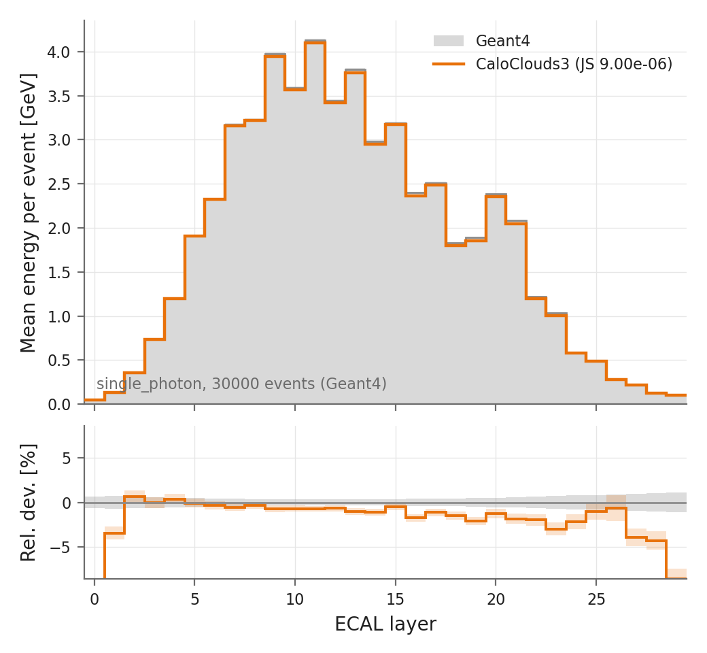
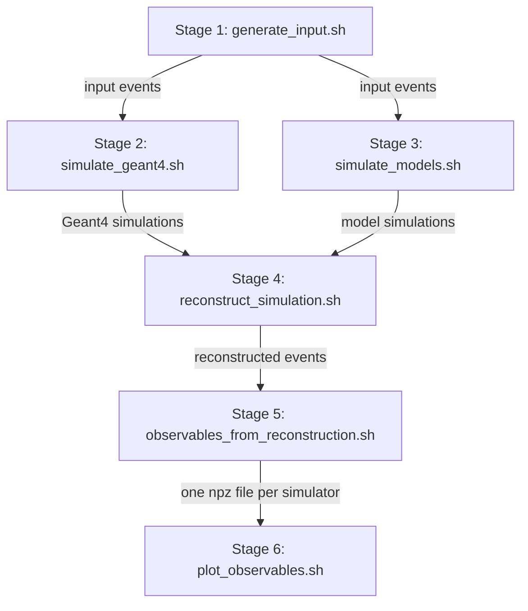

# FaSiNaTe

 [](https://opensource.org/licenses/Apache-2.0)
 [](https://github.com/HenryDayHall/FaSiNaTe/actions/workflows/ci.yml)

FaSiNaTe benchmarks generative fast-simulation models of calorimeter showers in ILD's full reconstruction chain. Each model runs inside `ddsim` through [DDML](https://github.com/key4hep/DDML), its events go through ILD's standard reconstruction, and standard 

<p align="center">
  
  
</p>

*Single photons of 10–100 GeV, CaloClouds3 (orange) against Geant4 (grey), with the relative deviation below.

More: [the stages, observables and figures](docs/stages.md) · [the models](docs/models.md)

## How to add a model

### 1. Describe it, with its inference code and weights

A model is a YAML file in [`models/`](models/), whose name is the model's name in commands and output folders, with its inference code in a Python module of the same name beside it and its weights in `models/weights/`. For example, `models/my_model.yaml`:

```yaml
name: My model                  # the label in the figures
representation: point_cloud     # or regular_grid

fixed_at_training:              # what the model has no input for
  detector:
    name: ILD_l5_o1_v02
    calorimeter: EcalBarrel
    compact_file: ILD/compact/ILD_l5_o1_v02/ILD_l5_o1_v02.xml  # simulated in this, relative to k4geo
  particle:
    name: gamma
    pdg: 22

context:                        # what each shower is conditioned on
  energy:
    unit: GeV
    training_range: [1, 127]
  direction:
    unit: deg
    training_range:
      frame: global
      theta: [30, 150]
      phi: [80, 110]

ddml:                           # how DDML runs it
  model_configs:
    - preset: CC3_BARREL_PY_INTERFACE   # a DDML embedded-Python plugin, with its geometry and trigger
      plugin_properties:
        PythonModule: my_model          # runs models/my_model.py
  weights_in: fasinate                  # the weights are in this repository,
  weights: models/weights/my_model.pt   # here (under GitHub's 100 MB per file)
  weights_md5: "0123456789abcdef0123456789abcdef"   # md5sum models/weights/my_model.pt

plot:
  color: "#7b3294"
  linestyle: "--"               # every model needs its own line style, as well as a colour
```

and `models/my_model.py`, which DDML's plugin runs inside `ddsim`:

```python
import os
import numpy as np
import torch
import yaml

_here = os.path.dirname(os.path.abspath(__file__))
with open(os.path.join(_here, "my_model.yaml")) as stream:
    _weights = yaml.safe_load(stream)["ddml"]["weights"]   # the file whose md5 sum is checked
_model = torch.jit.load(os.path.join(_here, "..", _weights)).eval()


@torch.inference_mode()
def run_inference(inputs):
    # inputs: float32 arrays of shape (1, 1), for CaloClouds3's plugin the energy
    # (GeV) and the polar and azimuthal angles (degrees, local frame); don't modify them
    out = _model(*[torch.from_numpy(a) for a in inputs])
    # one flat float32 array, as the plugin reads it
    return out.cpu().numpy().astype(np.float32, copy=False).ravel()
```

[`models/caloclouds3_recompiled.yaml`](models/caloclouds3_recompiled.yaml) and [`.py`](models/caloclouds3_recompiled.py) are a working example. Keep a model's own code in its one module. The model is then part of every run; `./simulate_models.sh --dry-run my_model` shows what it would simulate.

Models can also come from DDML directly, with DDML's own inference code and weights and no Python file, as in [`models/bibae_two_angle.yaml`](models/bibae_two_angle.yaml) (`presets: [BIBAE_BARREL]`).

### 2. Test it on GitHub's runners

Fork FaSiNaTe, keeping the fork public, enable Actions in it, and push your model. The [low-cost workflow](.github/workflows/low-cost.yml) then simulates, reconstructs and measures the first 1000 events of each input, and draws them against the published full samples. The plots and `dashboard.html` are on the run's page. A CaloClouds3-like model takes about 14 runner-hours. The runners don't time the model, so there are no Pareto fronts there: see [timing](#how-to-run-locally) below. The same test runs locally with `./low_cost.sh my_model`.

When the pipeline has completed, you can see the performance plots for your model in the artefacts of the job. The dashboard is html, so you can preview without downloading.
<p align="center">
  
</p>

*Select "Actions" -> your commit name for the "low-cost benchmark" -> "Artifacts" -> "dashboard.html"*

More: [models.md](docs/models.md) (every field, the models, closure tests) · [github.md](docs/github.md) (the GitHub runners, step by step) · [low_cost.md](docs/low_cost.md) (the low-cost mode, statistical floors)

## How to run locally

Six stages, one script each, run from the repository root. Each skips what is already done, so any of them can be run again after a failure.



**1. Clone the repository.**

```bash
git clone https://github.com/HenryDayHall/FaSiNaTe.git
cd FaSiNaTe
```

**2. Say where software and data go.** Save this as `configs/local.yaml`, which git ignores and every script reads:

```yaml
paths:
  software_dir: /data/dust/user/$USER/fasinate/external   # DDML, ILDConfig, the container image
  data_dir: /data/dust/user/$USER/fasinate/data           # inputs and outputs: hundreds of GB

# The software the published measurements were made with, to compare like with like
key4hep:
  release: "2026-04-08"
ddml:
  commit: "263256cca31b37335cd2aae34b81e899bd2a5851"
detector_configs:
  ildconfig:
    commit: "582efec42467362c389da073e7e21fb53a110315"
```

**3. Run the stages.** The first script builds DDML in a container, which takes a while; later runs reuse the build. Published inputs and measurements are fetched from Zenodo instead of being made, where they match the configuration. For a first test, add `-n 10` to stages 2–6: the first 10 events of each input, kept apart from the full samples.

```bash
./generate_input.sh                   # 1. the inputs of every scenario
./simulate_geant4.sh                  # 2. Geant4 (slow)
./simulate_models.sh                  # 3. every model in models/
./reconstruct_simulation.sh           # 4. every simulation
./observables_from_reconstruction.sh  # 5. one .npz per simulator
./plot_observables.sh                 # 6. figures, metrics.csv and dashboard.html
```

Every script takes `--help`, and stages 1–5 take `--dry-run` to show what is done and what is left.

**4. Time the simulators**, on the inputs of stage 1. The time per event, which the Pareto fronts plot accuracy against, is only measured locally, on slurm nodes or here, not on GitHub's runners. Times compare only between runs on the same kind of node.

```bash
./slurm_timing.sh --dry-run  # what would be timed, and the jobs it would submit
./slurm_timing.sh            # a job per input, simulator and kind of node (CPU and GPU)
./timing.sh my_model         # or here, one task after another (-d gpu on a GPU node)
./timing_summary.sh          # the table the plots read: timing/summary.csv
```

**5. Or run all six stages at once**, instead of step 3.

```bash
./pipeline.sh --config configs/pipeline_test.yaml  # a very light test of every stage
./pipeline.sh                                      # every stage, here, one task after another
./slurm_pipeline.sh --dry-run                      # on slurm: what is done, and what would be submitted
./slurm_pipeline.sh                                # on slurm: a job per file, from a login node
```

More: [running.md](docs/running.md) (options, configuration, environment, where the data goes) · [stages.md](docs/stages.md) (each stage, the observables, the figures) · [published.md](docs/published.md) (published data) · [timing.md](docs/timing.md) (the timing benchmark) · [development.md](docs/development.md) (extending, tests, layout)

## Credits

FaSiNaTe grew out of an analysis chain for CaloClouds-style models in full simulation and reconstruction, originally written by Peter McKeown, Anatolii Korol and Henry Day-Hall. The fast simulation runs through [DDML](https://github.com/key4hep/DDML), and the benchmark design follows *"A First Full Physics Benchmark for Highly Granular Calorimeter Surrogates"*.
