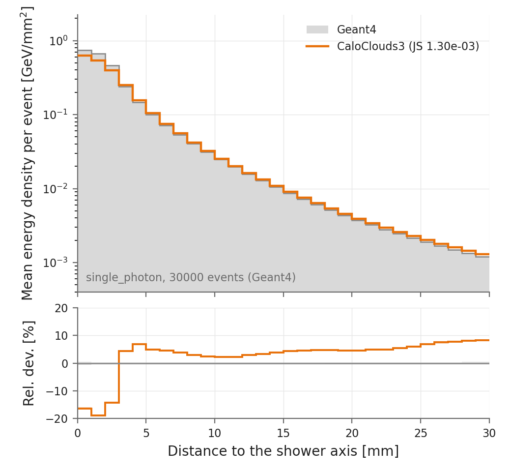
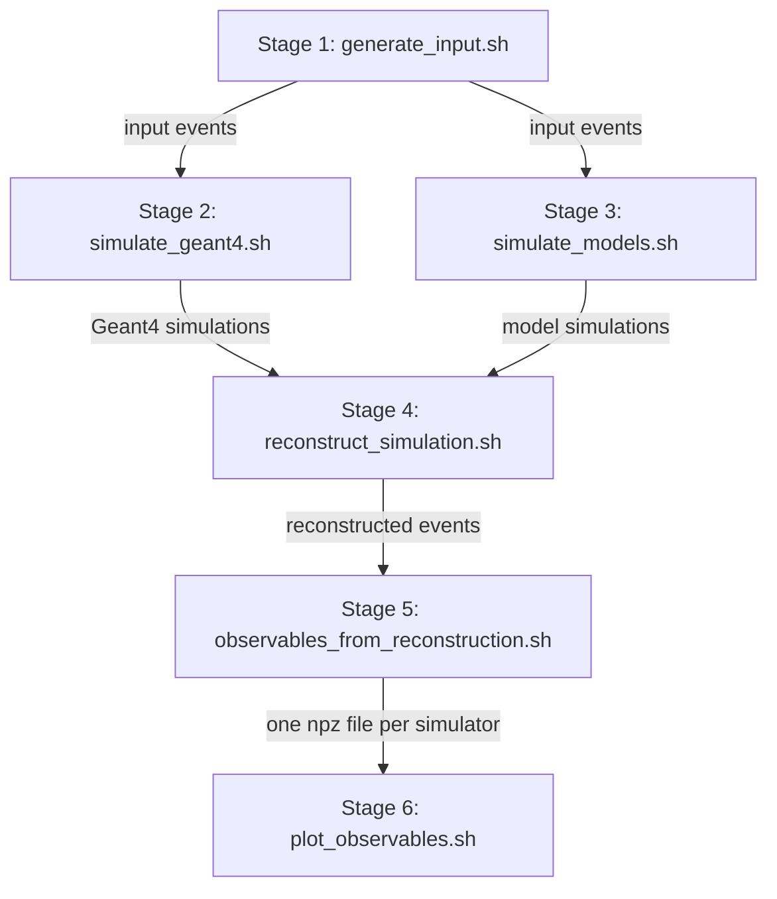

# FaSiNaTe

FaSiNaTe benchmarks generative fast-simulation models of calorimeter showers in a full detector chain.
Each model runs inside ILD's `ddsim` simulation through [DDML](https://github.com/key4hep/DDML), its events go through ILD's standard reconstruction, and observables measured on the reconstructed events are compared with full Geant4 simulation of the same inputs.

The benchmark follows the paper *"A First Full Physics Benchmark for Highly Granular Calorimeter Surrogates"*, starting with its single-photon shower profiles. The first model included is CaloClouds3.

<p align="center">
  
  
</p>

*Example output of `plot_observables.sh` for the `single_photon` scenario (30 000 Geant4 events, 10–100 GeV): the mean reconstructed ECAL energy per layer (left) and against distance to the shower axis (right). Geant4 is the grey filled histogram, CaloClouds3 the orange line; the lower panels show the relative deviation from Geant4 with statistical uncertainties, and the legend gives the Jensen–Shannon divergence.*

## Contents

- [The pipeline](#the-pipeline)
- [Quick start](#quick-start)
- [The whole pipeline at once](#the-whole-pipeline-at-once)
- [Configuration](#configuration)
- [The environment](#the-environment)
- [Stage by stage](#stage-by-stage)
  - [1. Generate the inputs](#1-generate-the-inputs)
  - [2. Simulate with Geant4](#2-simulate-with-geant4)
  - [3. Simulate with the models](#3-simulate-with-the-models)
  - [4. Reconstruct](#4-reconstruct)
  - [5. Measure the observables](#5-measure-the-observables)
  - [6. Plot](#6-plot)
- [Where the data goes](#where-the-data-goes)
- [Extending the benchmark](#extending-the-benchmark)
- [Tests](#tests)
- [Repository layout](#repository-layout)
- [Credits](#credits)

## The pipeline

Every stage is one script at the top of the repository. The scripts take their settings from the configuration, find the work left to do from what is already on disk, and skip what is finished, so any stage can be re-run safely after a failure or timeout. Behind them is one harness, [`ddml_bench/`](ddml_bench/) ([`docs/harness.md`](docs/harness.md)): a single module names every file, each stage declares its tasks, one per file, and the same task graph is run one task after another by `pipeline.sh` and the stage scripts, or as slurm jobs by `slurm_pipeline.sh`.



| Stage | Script | Reads | Writes (under `paths.data_dir`) |
|---|---|---|---|
| 1 | `generate_input.sh` | `scenarios` in the configuration | `input_single_particle_gun/*.slcio` (+ `.h5` truth) |
| 2 | `simulate_geant4.sh` | scenario inputs | `sim_output/<scenario>/geant4/*.edm4hep.root` |
| 3 | `simulate_models.sh` | scenario inputs, `models/*.yaml` | `sim_output/<scenario>/<model>/*.root` |
| 4 | `reconstruct_simulation.sh` | everything in `sim_output/` | `rec_output/<scenario>/<simulator>/*_REC.edm4hep.root` |
| 5 | `observables_from_reconstruction.sh` | finished reconstructions | `observables/<simulator>.npz` |
| 6 | `plot_observables.sh` | `observables/*.npz` | `observables/plots/*.{pdf,png}`, `metrics.csv` |

Stages 2 and 3 are independent of each other; a "simulator" below means either Geant4 or one of the models. [`pipeline.sh`](#the-whole-pipeline-at-once) runs all six stages in one go, and on a slurm cluster [`slurm_pipeline.sh`](#the-whole-pipeline-at-once) runs them as jobs of one file each.

## Quick start

```bash
git clone https://github.com/HenryDayHall/FaSiNaTe.git
cd FaSiNaTe

# Say where software and (large) data should live
cat > configs/local.yaml <<'EOF'
paths:
  software_dir: /data/dust/user/$USER/fasinate/external
  data_dir: /data/dust/user/$USER/fasinate/data
EOF

./generate_input.sh                 # 1. inputs for every scenario
./simulate_geant4.sh                # 2. Geant4 (slow: on slurm, use slurm_pipeline.sh)
./simulate_models.sh                # 3. every model in models/
./reconstruct_simulation.sh         # 4. every simulation
./observables_from_reconstruction.sh  # 5. one .npz per simulator
./plot_observables.sh               # 6. figures and metrics.csv
```

or all six at once with `./pipeline.sh`, or `./slurm_pipeline.sh` on a slurm cluster. The first script to run builds DDML (and anything else the environment needs, see [below](#the-environment)), which takes a while; later runs reuse the build.

Before a full run, try the chain on a handful of events. Stages 2–6 take `-n N`: the simulation of the first N events of each input is named `<input>_n<N>`, and everything made from it carries that name on (`<input>_n<N>_REC.edm4hep.root`, `<simulator>_n<N>.npz`, `metrics_n<N>.csv`), so a test run never mixes with the full samples:

```bash
./simulate_geant4.sh -n 10
./simulate_models.sh -n 10
./reconstruct_simulation.sh -n 10
./observables_from_reconstruction.sh -n 10
./plot_observables.sh -n 10
```

Every script takes `--help`, and stages 1–5 also take `--dry-run`, showing what would be done and what is already done, `-f/--force` to make their outputs again, and `-c/--config FILE` to merge a configuration file over the others. Run them from the repository root (or set `FASINATE_REPO_DIR`). Apart from `slurm_pipeline.sh`, which submits its own jobs, the long-running ones can be submitted directly with `sbatch` from the repository root; their `#SBATCH` defaults are set for DESY's Maxwell cluster.

## The whole pipeline at once

`pipeline.sh` runs every stage here, one task after another, and `slurm_pipeline.sh` runs them on a slurm cluster. Both work out what each stage still has to do from what is on disk, as tasks of one file each, each waiting for the tasks that make what it reads; `slurm_pipeline.sh` submits each task as a job (`sbatch --dependency=afterok`):

| Stage | One task (job) for each | Waiting for |
|---|---|---|
| generate | input file still to make | |
| geant4 | input still to simulate with Geant4 | the task making its input |
| models | input and model still to simulate | the task making its input |
| reconstruct | simulation still to reconstruct | the task simulating it |
| observables | simulator whose measurements aren't up to date | the tasks reconstructing its simulations |
| plot | (one task) | the measurement tasks |

Try it first with [`configs/pipeline_test.yaml`](configs/pipeline_test.yaml), a very light test of every stage: two inputs of 10 photons each, in a data folder of its own, with short time limits. With CaloClouds3 alone, that is 13 tasks.

```bash
./slurm_pipeline.sh --config configs/pipeline_test.yaml --dry-run  # what is done, and what would be submitted
./slurm_pipeline.sh --config configs/pipeline_test.yaml            # the test
./slurm_pipeline.sh                                                # the full benchmark
./pipeline.sh --config configs/pipeline_test.yaml                  # the test, here, one task after another
```

Run `slurm_pipeline.sh` on a login node, from the repository root. Before submitting anything it works out what is done and runs the stages' checks in the environment the jobs get (building DDML first if needed, which `--dry-run` does too), so that a missing model weight or compact file stops it there rather than failing every job. Like the stage scripts, both take simulators and `-s SCENARIO` to run only those, and `-n N` for a test on the first N events of each input; `-c/--config FILE` merges a configuration file over the others, for this run and all its jobs. `--stages` runs only some stages, `--force STAGE` makes a stage's outputs again and with them everything made from them, and for `slurm_pipeline.sh`, options after `--` go to every `sbatch` call:

```bash
./slurm_pipeline.sh caloclouds3               # this model's jobs, then the plots
./slurm_pipeline.sh --stages generate,geant4  # only the inputs and the Geant4 reference
./slurm_pipeline.sh --force reconstruct       # reconstruct everything again, and measure and plot it
./slurm_pipeline.sh -- --account=myproject    # more sbatch options
```

Either can be run again at any time. What is done is skipped, and whatever failed or timed out is run again. A task needing one that failed isn't run (a job waiting for one that fails is cancelled), so after a failure, fix what went wrong and run the script again. A task that a job of an earlier submission is still queued or running for is waited for, not submitted again. Adding a model to `models/` and running it again runs that model's tasks and the plots.

Each submission of `slurm_pipeline.sh` gets a folder, `slurm/pipeline_<time>/` in `paths.data_dir`, with the job script, the jobs submitted (`jobs.tsv`), what was done and why (`tasks.json`) and each job's slurm log in `logs/`. Every job runs one task of `tasks.json`, `scripts/ddml-bench run-task`, in the environment from `setup.sh`; the tasks write their logs next to their outputs, as the stage scripts do. The partition, constraint, time limit and other `sbatch` options of each stage's jobs are in the `slurm` section of the configuration.

## Configuration

Shared settings live in [`configs/default.yaml`](configs/default.yaml):

- `paths`: where external software is built (`software_dir`), where all inputs and outputs go (`data_dir`), and where the steering file finds model weights (`model_dir`);
- `ddml`, `key4hep`, `container`, `detector_configs`, `patches`: the software stack (see [The environment](#the-environment));
- `geant4`, `reconstruction`: settings for the reference simulation and the reconstruction;
- `scenarios`: the sets of events every simulator simulates;
- `observables`: what is measured on them, and how it is compared with Geant4;
- `slurm`: the jobs of [`slurm_pipeline.sh`](#the-whole-pipeline-on-slurm), stage by stage.

Don't edit `default.yaml` for your own setup. Put the settings you change in `configs/local.yaml`, which git ignores and every script reads automatically. An override file only needs the keys it changes, e.g. a smaller single-photon sample for testing:

```yaml
scenarios:
  single_photon:
    input:
      n_events: 100
```

(Input file names don't include the number of events, so this replaces the full samples; use `-n` instead to test without touching them, or a data folder of its own, as [`configs/pipeline_test.yaml`](configs/pipeline_test.yaml) does.)

Values can refer to other settings (`${paths.software_dir}`) and to environment variables (`$USER`); relative paths are relative to the repository. More override files can be layered on top by listing them in `FASINATE_CONFIG`. Inspect the merged result with

```bash
python3 scripts/fasinate_config.py                      # everything
python3 scripts/fasinate_config.py --get paths.data_dir  # one setting
```

This needs Python 3 with PyYAML (`python3 -m pip install --user pyyaml`).

Each model has its own file in [`models/`](models/); see [Adding a model](#adding-a-model).

## The environment

Every stage runs in the same environment: a Key4hep release, a build of DDML's `python-inference` branch against it, ILDConfig for the reconstruction, and any patches the release still needs. You don't normally have to set this up yourself: each script builds what is missing, then runs its work in a clean shell inside an Apptainer/Singularity container (`container.image`, AlmaLinux 9 by default) with `/cvmfs` mounted. Set `container.enabled: false` to run directly on a host with a matching OS and `/cvmfs`, e.g. in CI. One launcher does this for every script, `scripts/run_in_environment.sh`, with the clean shell and the container set up by `scripts/environment.sh`, which the build scripts use too.

For interactive work, get the same environment in a clean bash shell with

```bash
source setup.sh
```

Source it only once per shell, as the Key4hep setup can only run once. In a shell that has sourced it, the stage scripts run in place rather than starting a container.

What it sets up, and the scripts that do it:

- **DDML** — `scripts/build_ddml.sh` clones DDML into `ddml.source_dir` (at `ddml.commit` if set, otherwise the head of `ddml.branch`), pulls the container image if needed, builds DDML inside it against `key4hep.release`, and writes `ddml.env_file`. Building also downloads DDML's reference models into `paths.model_dir`. It rebuilds only when the DDML commit or branch, the build options, the Key4hep release or the image change. Run it by hand to move to the head of the branch (`--dry-run`, `--clean`, `--config FILE` and `--set section.key=value` are available); it prints the commit and release used, ready to pin in `configs/local.yaml`.
- **ILDConfig** — Key4hep releases don't include it, so `scripts/fetch_detector_configs.sh` clones it to `detector_configs.ildconfig.source_dir`. Pin `detector_configs.ildconfig.commit` for benchmark runs.
- **Patches** — fixes that are upstream but not yet in a Key4hep release, built by `scripts/build_patches.sh` (see [Patches to the Key4hep release](#patches-to-the-key4hep-release)).

For benchmark runs, pin `ddml.commit`, `key4hep.release` and `detector_configs.ildconfig.commit` so results are reproducible.

### Patches to the Key4hep release

Each entry under `patches` rebuilds one package of the release from a newer version and swaps its library into `MARLIN_DLL`. There is one so far:

- `marlintrkprocessors`: up to version 2.12.8, ILD's TPC digitisation (`DDTPCDigiProcessor`) aborts the whole job with `padTheta = nan` on some hit triplets, which backscatter from Geant4 showers can produce. The fix, [iLCSoft/MarlinTrkProcessors#79](https://github.com/iLCSoft/MarlinTrkProcessors/commit/f2da912fa583eb6da3e9aac4c8ba43fcde64efab), is in `v02-12-09`, which is what gets built.

A patch is only used while the release's own version is older than its `fixed_in`. Once DDML is built against a release that has the fix, `setup.sh` stops using it and says the entry can be deleted from `configs/default.yaml`. To run without a patch before then, set `patches.<name>.enabled: false` in `configs/local.yaml`. The patches in use are printed by `setup.sh` and recorded in each reconstruction log.

## Stage by stage

### 1. Generate the inputs

```bash
./generate_input.sh                # every scenario
./generate_input.sh single_photon  # just this one
```

Each scenario's `input` section says how its events are made. The `particle_gun` type runs [`ILD_Particle_Gun.py`](ILD_Particle_Gun.py) once per energy, with the remaining keys passed as its options; the i-th energy uses `seed + i`, so the samples are independent. Each energy gives an `.slcio` file of starting particles and an `.h5` file of the true energies, momenta and gun positions, in `input_single_particle_gun/`. Each is made in a hidden folder and moved into place when complete; inputs that exist are skipped, unless `-f` is given.

The default `single_photon` scenario fires photons from the IP into one stave of the ECAL barrel, at 10, 20, …, 100 GeV with 3000 events each, spread uniformly over the front face of the stave.

### 2. Simulate with Geant4

Full Geant4 is the reference the models are compared with. `simulate_geant4.sh` runs `ddsim` with DDML's steering file but without DDML's fast simulation ([`scripts/ddsim_steer_geant4.py`](scripts/ddsim_steer_geant4.py)), so every other setting (physics list, crossing angle, filters, …) matches the model simulations, in the detector `geant4.compact`.

```bash
./simulate_geant4.sh --dry-run                    # what's left to do
./simulate_geant4.sh -s single_photon             # one scenario, all inputs in sequence
./simulate_geant4.sh --file <input>.slcio         # a single input
```

Geant4 is slow, so on a slurm cluster use `slurm_pipeline.sh --stages geant4`, which submits one job per input (`slurm_simulate_geant4.sh` now runs just that):

```bash
./slurm_pipeline.sh --stages geant4                         # one job per input still to simulate
./slurm_pipeline.sh --stages geant4 -- --time 3-00:00:00    # options after -- go to sbatch
```

### 3. Simulate with the models

`simulate_models.sh` simulates every scenario's inputs with every model in `models/` (or those named), running `ddsim` with each model's DDML presets as in DDML's README.

```bash
./simulate_models.sh --dry-run
./simulate_models.sh                              # every model, every scenario
./simulate_models.sh -s single_photon caloclouds3 # one scenario, one model
```

Before simulating, it checks that the DDML libraries, the `ddml` Python package and each preset's plugin come from the configured build, and that each model's weights match their recorded md5 sum. Each model is simulated in the detector it was trained for (`fixed_at_training.detector.compact_file`).

Both simulation scripts accept `-i FILE` to simulate an arbitrary input file (written under the scenario name `custom`), `--file FILE` to simulate just that one of the scenarios' inputs, and `-f/--force` to redo existing outputs. `ddsim` writes to a hidden file that is renamed only on success, so an output that exists is always complete. An input that isn't made yet is an error.

### 4. Reconstruct

The simulations are reconstructed with ILD's standard reconstruction under Gaudi: ILDConfig's `ILDReconstruction.py` run with `k4run`, as in the Key4hep tutorial [ILD Simulation and Reconstruction with Key4hep](https://key4hep.github.io/key4hep-doc/main/tutorials/key4hep-tutorials/gaudi_ild_reco/README.html).

```bash
./reconstruct_simulation.sh --dry-run
./reconstruct_simulation.sh                         # every finished simulation
./reconstruct_simulation.sh -s single_photon geant4 # one scenario, one simulator
./reconstruct_simulation.sh path/to/sim.root        # one file
```

It reconstructs the simulations of the scenarios' inputs, by Geant4 and by every model, each in the detector it was simulated in (`--compact FILE` overrides this). Each `<name>.root` becomes `<name>_REC.edm4hep.root`, alongside `<name>_AIDA.root`, `<name>_PfoAnalysis.root` and the log. With `-n N` it reconstructs the simulations of the first N events, `<input>_n<N>`, whole; simulation files can also be given directly, and `-s custom` reconstructs what was simulated with `-i`. `--noBeamCalReco` is always passed, and `--usingParticleGun` for particle-gun scenarios; further arguments for `ILDReconstruction.py` go in `reconstruction.extra_args` (e.g. `[--lcioOutput, "on"]` to also write LCIO). As with simulation, outputs appear only once complete and existing ones are skipped unless `--force` is given.

### 5. Measure the observables

`observables_from_reconstruction.sh` measures every observable in the configuration for each simulator whose reconstruction is finished, i.e. every input of every scenario the observables use has its `_REC.edm4hep.root`.

```bash
./observables_from_reconstruction.sh --dry-run
./observables_from_reconstruction.sh                 # every finished simulator
./observables_from_reconstruction.sh caloclouds3 geant4
```

The current observables are the shower profiles from the benchmark paper, measured on reconstructed ECAL barrel hits in the `single_photon` scenario:

- `radial_profile`: mean hit energy per unit area (GeV/mm²) against the distance from the incident photon's line of flight to the hit's cell centre, i.e. the energy in each ring around the line of flight divided by the ring's area, π(r<sub>out</sub>² − r<sub>in</sub>²), so that the rings growing with the radius don't skew it; once out to 100 mm (50 bins) and once out to 30 mm (30 bins) to resolve the core;
- `longitudinal_profile`: mean hit energy per ECAL layer, decoded from the hits' cellIDs.

For each simulator it writes `observables/<simulator>.npz`, holding every profile per input file as sums over events of each bin's energy and squared energy, plus the event count. From these the mean per event and its statistical uncertainty follow, for all energies combined or each separately ([`ddml_bench/measure.py`](ddml_bench/measure.py) documents the keys). The reconstructed files are recorded relative to `paths.data_dir`, so the files stay valid when copied elsewhere. A simulator is skipped if its file already has every requested key, computed with the same settings from the same files.

The cellID encoding is read from the reconstructed file, or failing that from the detector geometry; set `observables.longitudinal_profile.cell_id_encoding` to give it by hand. A warning is printed if more than 1% of a file's hits fall outside layers 0 to `max_layer`, which usually means the encoding is wrong.

### 6. Plot

```bash
./plot_observables.sh                                     # everything found, to observables/plots/
./plot_observables.sh caloclouds3                         # just this model against Geant4
./plot_observables.sh -d copied/observables -o figures    # e.g. on a laptop, from copied .npz files
./plot_observables.sh --format pdf                        # default is pdf,png
```

Each figure, `<observable>_<profile>__<scenario>.<format>` (e.g. `radial_profile_r30__single_photon.png`, shown [at the top](#fasinate)), puts every simulator on the same axes: Geant4 as a grey filled histogram, each model as a line with its uncertainty band, and each model's relative deviation from Geant4 underneath. The legend gives each model's distance from Geant4 using the observable's `metric` (currently the Jensen–Shannon divergence), and all metrics are collected in `metrics.csv`. The `.npz` files hold the energy per ring of the radial profiles, which is divided by the rings' areas only when drawn; the metric compares the fractions of the energy in the bins, and the relative deviations are ratios, so neither depends on that division.

Plotting only needs numpy and matplotlib: it uses your own `python3` if it has them, and the `setup.sh` environment otherwise, so the `.npz` files can be copied elsewhere and plotted there.

## Where the data goes

Everything is written under `paths.data_dir`:

```
<data_dir>/
├── input_single_particle_gun/     # stage 1: <input>.slcio + <input>.h5
├── sim_output/
│   └── <scenario>/
│       ├── geant4/                # stage 2: <input>.edm4hep.root + log
│       └── <model>/               # stage 3: <input>.root + log
├── rec_output/
│   └── <scenario>/<simulator>/    # stage 4: <input>_REC.edm4hep.root, _AIDA.root, _PfoAnalysis.root, .log
├── observables/
│   ├── <simulator>.npz            # stage 5
│   └── plots/                     # stage 6: figures + metrics.csv
└── slurm/
    └── pipeline_<time>/           # submissions of slurm_pipeline.sh (slurm.log_dir)
```

One module, [`ddml_bench/layout.py`](ddml_bench/layout.py), names all of these. Test runs with `-n N` add `_n<N>` to every file name after the inputs, and files simulated with `-i` go under the scenario `custom` (reconstructions of files outside `sim_output` go to `rec_output/custom/files/`).

## Extending the benchmark

### Adding a model

Add a YAML file to `models/`; its file name becomes the model's name in commands and output folders. [`models/caloclouds3.yaml`](models/caloclouds3.yaml) is a commented example. It records:

- `representation`: how the model describes a shower, e.g. `point_cloud`;
- `fixed_at_training`: what the model has no input for, so where it is valid: the detector (and the compact file to simulate it in) and the particle;
- `context`: what the model is conditioned on for each shower, e.g. energy and direction, with units and training ranges;
- `ddml`: how to run it — the DDML presets (from `python/ddml/configs.py` in DDML) passed to `ddsim --ml-model`, and the weights file with its md5 sum;
- `plot`: its colour and line style in the figures (each model needs a distinct line style as well as a colour, so curves can be told apart without colour).

Put the weights in `paths.model_dir` (by default DDML's `models/` folder, mounted as `/model_dir` for the steering file), or point `paths.model_dir` elsewhere. The model then takes part in stages 3–6 automatically.

### Adding a scenario

Add an entry under `scenarios` with an `input` section. Input types are defined in `INPUT_TYPES` in [`ddml_bench/scenarios.py`](ddml_bench/scenarios.py) (currently `particle_gun`); a new type needs a function that returns the commands making the inputs, one that names the files they produce without running them, and the option that makes a command write into a given folder. List the scenario under the `scenarios` of each observable that should be measured on it.

### Adding an observable

Observables are implemented in [`ddml_bench/measure.py`](ddml_bench/measure.py), keyed by the name used under `observables` in the configuration, and the comparison metrics in [`ddml_bench/plot.py`](ddml_bench/plot.py).

### Adding a stage

Each stage is a class in [`ddml_bench/stages/`](ddml_bench/stages/) that adds its tasks to the graph and says when one is done, what it needs from the environment and how to run one; [`docs/harness.md`](docs/harness.md) describes them.

## Tests

```bash
python3 -m pip install pyyaml numpy awkward uproot matplotlib h5py particle pytest
python3 -m pytest tests
```

The tests run the scripts end to end, `pipeline.sh` and `slurm_pipeline.sh` included, through the same launcher and `setup.sh` as on the cluster, with only the programs at the ends faked ([`tests/fakes/`](tests/fakes/)): `ddsim`, `k4run` (which writes real EDM4hep-style ROOT files, so the observables and plots run for real), pyLCIO, DDML's Python package, and slurm's `sbatch` and `squeue`. They need no Key4hep, CVMFS or slurm, and run in CI on every push ([`.github/workflows/ci.yml`](.github/workflows/ci.yml)), with shellcheck on the scripts.

## Repository layout

```
├── generate_input.sh                   # stage 1
├── simulate_geant4.sh                  # stage 2
├── simulate_models.sh                  # stage 3
├── reconstruct_simulation.sh           # stage 4
├── observables_from_reconstruction.sh  # stage 5
├── plot_observables.sh                 # stage 6
├── pipeline.sh                         # all six stages, here, one task after another
├── slurm_pipeline.sh                   # all six stages, as slurm jobs of one file each
├── slurm_simulate_geant4.sh            #   ... just the Geant4 stage
├── setup.sh                            # interactive environment
├── ILD_Particle_Gun.py                 # particle-gun input generator
├── configs/default.yaml                # shared configuration (override in configs/local.yaml)
├── configs/pipeline_test.yaml          # a very light test run of the whole pipeline
├── models/                             # one YAML file per model
├── ddml_bench/                         # the harness: layout, stages, task graph, executors
├── scripts/                            # building, the environment launcher, the ddml-bench command
├── tests/                              # the tests, with the fakes they run the pipeline on
├── docs/                               # harness.md, and figures for this README
└── di_photon_old/                      # the earlier di-photon separation analysis (legacy)
```

Some files predate the current pipeline and are kept for reference only: `di_photon_old/` (the di-photon separation analysis by Peter McKeown and Anatolii Korol; its `ddml_diphoton_analysis_submodule` is the only git submodule, and the pipeline doesn't need it), `MarlinStdReco_WITH_GAPS.xml` (the earlier Marlin reconstruction, replaced by the Gaudi one in stage 4), `create_singularity.sh` (an old Ubuntu 22.04 container setup; the image is now pulled automatically) and `MODELS.md` (names of older CaloClouds variants).

## Credits

FaSiNaTe grew out of an analysis chain for CaloClouds-style models in full simulation and reconstruction, originally written by Peter McKeown and Anatolii Korol. The fast simulation runs through [DDML](https://github.com/key4hep/DDML), and the benchmark design follows *"A First Full Physics Benchmark for Highly Granular Calorimeter Surrogates"*.
