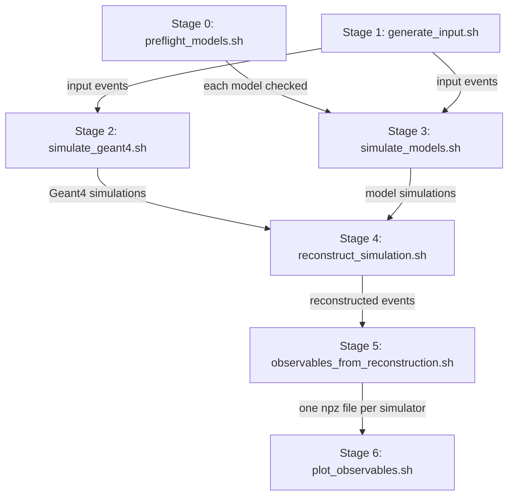

# Running the pipeline

How to run FaSiNaTe here or on a slurm cluster, in detail. The README's [How to run locally](../README.md#how-to-run-locally) has the short version.

## The pipeline

Every stage is one script at the top of the repository. The scripts take their settings from the configuration, find the work left to do from what is already on disk, and skip what is finished, so any stage can be re-run safely after a failure or timeout. Behind them is one harness, [`ddml_bench/`](../ddml_bench/) ([`docs/harness.md`](harness.md)): a single module names every file, each stage declares its tasks, one per file, and the same task graph is run one task after another by `pipeline.sh` and the stage scripts, or as slurm jobs by `slurm_pipeline.sh`.



| Stage | Script | Reads | Writes (under `paths.data_dir`) |
|---|---|---|---|
| 0 | `preflight_models.sh` | `models/*.yaml`, a model's own code and weights | `preflight_output/summary.txt`, and `preflight_output/<model>/`: its summary, full log, plots of its barrel shots |
| 1 | `generate_input.sh` | `scenarios` in the configuration | `input_single_particle_gun/*.slcio` (+ `.h5` truth); the physics samples, made elsewhere, are taken as they are from `input_physics_samples/` |
| 2 | `simulate_geant4.sh` | scenario inputs | `sim_output/<scenario>/geant4/*.edm4hep.root`, and Geant4's second sample in `sim_output/<scenario>/geant4_2/` |
| 3 | `simulate_models.sh` | scenario inputs, `models/*.yaml` | `sim_output/<scenario>/<model>/*.root` |
| 4 | `reconstruct_simulation.sh` | everything in `sim_output/` | `rec_output/<scenario>/<simulator>/*_REC.edm4hep.root` |
| 5 | `observables_from_reconstruction.sh` | finished reconstructions | `observables/<simulator>.npz` |
| 6 | `plot_observables.sh` | `observables/*.npz` | `observables/plots/*.{pdf,png}`, `dashboard.html`, `metrics.csv`, `fits.csv` |

Stage 0 checks each model before it is simulated ([stages.md](stages.md#0-check-the-models)): stage 3, the pipeline and the low-cost mode run it first, for each model with something still to simulate, and simulate nothing of a model until it passes. Stages 2 and 3 are independent of each other; a "simulator" below means either Geant4 (`geant4`, or its second sample, `geant4_2`) or one of the models. [`pipeline.sh`](#the-whole-pipeline-at-once) runs all six stages in one go, and on a slurm cluster [`slurm_pipeline.sh`](#the-whole-pipeline-at-once) runs them as jobs of one file each.

## Test runs and options

The first script to run builds DDML (and anything else the environment needs, see [below](#the-environment)), which takes a while; later runs reuse the build.

Before a full run, try the chain on a handful of events. Stages 2–6 take `-n N`: the simulation of the first N events of each input is named `<input>_n<N>`, and everything made from it carries that name on (`<input>_n<N>_REC.edm4hep.root`, `<simulator>_n<N>.npz`, `metrics_n<N>.csv`), so a test run never mixes with the full samples:

```bash
./simulate_geant4.sh -n 10
./simulate_models.sh -n 10
./reconstruct_simulation.sh -n 10
./observables_from_reconstruction.sh -n 10
./plot_observables.sh -n 10
```

Every script takes `--help`, and stages 1–5 also take `--dry-run`, showing what would be done and what is already done, `-f/--force` to make their outputs again, and `-c/--config FILE` to merge a configuration file over the others. Run them from the repository root (or set `FASINATE_REPO_DIR`). Apart from `slurm_pipeline.sh`, which submits its own jobs, the long-running ones can be submitted directly with `sbatch` from the repository root; their `#SBATCH` defaults are set for DESY's Maxwell cluster.

## The whole pipeline at once

`pipeline.sh` runs every stage here, one task after another, and `slurm_pipeline.sh` runs them on a slurm cluster. Both work out what each stage still has to do from what is on disk, as tasks of one file each, each waiting for the tasks that make what it reads; `slurm_pipeline.sh` submits each task as a job (`sbatch --dependency=afterok`):

| Stage | One task (job) for each | Waiting for |
|---|---|---|
| generate | input file still to make | |
| geant4 | input still to simulate with Geant4, and again for its second sample | the task making its input |
| models | input and model still to simulate | the task making its input |
| reconstruct | simulation still to reconstruct | the task simulating it |
| observables | simulator whose measurements aren't up to date | the tasks reconstructing its simulations |
| plot | (one task) | the measurement tasks |

Try it first with [`configs/pipeline_test.yaml`](../configs/pipeline_test.yaml), a very light test of every stage: two inputs of 10 photons each and one of 10 photon pairs in three segments, each simulated with two seeds, in a data folder of its own, with short time limits. With the four models in `models/`, and Geant4's second sample, that is 108 tasks (57 with one model).

```bash
./slurm_pipeline.sh --config configs/pipeline_test.yaml --dry-run  # what is done, and what would be submitted
./slurm_pipeline.sh --config configs/pipeline_test.yaml            # the test
./slurm_pipeline.sh                                                # the full benchmark
./pipeline.sh --config configs/pipeline_test.yaml                  # the test, here, one task after another
```

Run `slurm_pipeline.sh` on a login node, from the repository root. Before submitting anything it works out what is done and runs the stages' checks in the environment the jobs get (building DDML first if needed, which `--dry-run` does too), so that a missing model weight or compact file stops it there rather than failing every job. Like the stage scripts, both take simulators and `-s SCENARIO` to run only those, and `-n N` for a test on the first N events of each input; `-c/--config FILE` merges a configuration file over the others, for this run and all its jobs. `--stages` runs only some stages, `--force STAGE` makes a stage's outputs again and with them everything made from them, and for `slurm_pipeline.sh`, options after `--` go to every `sbatch` call:

```bash
./slurm_pipeline.sh caloclouds3               # this model's jobs, then the plots
./slurm_pipeline.sh --stages generate,geant4  # only the inputs and the Geant4 reference
./slurm_pipeline.sh --force reconstruct       # reconstruct everything again, and measure and plot it
./slurm_pipeline.sh -- --account=myproject    # more sbatch options
```

Either can be run again at any time. What is done is skipped, and whatever failed or timed out is run again. A task needing one that failed isn't run (a job waiting for one that fails is cancelled), so after a failure, fix what went wrong and run the script again. A task that a job of an earlier submission is still queued or running for is waited for, not submitted again. Adding a model to `models/` and running it again runs that model's tasks and the plots.

The simulations and reconstructions are only made for what is still to be made from them. One that isn't there isn't made while what it is for is done: a simulation whose reconstruction is there, or the simulations and reconstructions of a simulator whose measurements are up to date, as its `.npz` file records what it was measured from. So once a simulator is measured, its simulations and reconstructions can be deleted (to save space) without being made again, and measurements fetched along with the inputs need no simulation at all ([Reusing published measurements](published.md#reusing-published-measurements)). The stage scripts work the same way; `--dry-run` reports such tasks as `not needed`, and `--force` (`-f`) makes them anyway.

Each submission of `slurm_pipeline.sh` gets a folder, `slurm/pipeline_<time>/` in `paths.data_dir`, with the job script, the jobs submitted (`jobs.tsv`), what was done and why (`tasks.json`) and each job's slurm log in `logs/`. Every job runs one task of `tasks.json`, `scripts/ddml-bench run-task`, in the environment from `setup.sh`; the tasks write their logs next to their outputs, as the stage scripts do. The partition, constraint, time limit and other `sbatch` options of each stage's jobs are in the `slurm` section of the configuration.

## Configuration

Shared settings live in [`configs/default.yaml`](../configs/default.yaml):

- `paths`: where external software is built (`software_dir`), where all inputs and outputs go (`data_dir`), and where the steering file finds model weights (`model_dir`);
- `ddml`, `key4hep`, `container`, `detector_configs`, `patches`: the software stack (see [The environment](#the-environment));
- `geant4`, `reconstruction`: settings for the reference simulation and the reconstruction;
- `scenarios`: the sets of events every simulator simulates (one with `enabled: false` is left out of every run);
- `observables`: what is measured on them, and how it is compared with Geant4;
- `published`: the published data (Zenodo records) a run fetches instead of making it ([Reusing published measurements](published.md#reusing-published-measurements));
- `slurm`: the jobs of [`slurm_pipeline.sh`](#the-whole-pipeline-at-once), stage by stage.

Don't edit `default.yaml` for your own setup. Put the settings you change in `configs/local.yaml`, which git ignores and every script reads automatically. An override file only needs the keys it changes, e.g. a smaller single-photon sample for testing:

```yaml
scenarios:
  single_photon:
    input:
      n_events: 100
```

(Input file names don't include the number of events, so this replaces the full samples; use `-n` instead to test without touching them, or a data folder of its own, as [`configs/pipeline_test.yaml`](../configs/pipeline_test.yaml) does.)

Values can refer to other settings (`${paths.software_dir}`) and to environment variables (`$USER`); relative paths are relative to the repository. More override files can be layered on top by listing them in `FASINATE_CONFIG`. Inspect the merged result with

```bash
python3 scripts/fasinate_config.py                      # everything
python3 scripts/fasinate_config.py --get paths.data_dir  # one setting
```

This needs Python 3 with PyYAML (`python3 -m pip install --user pyyaml`).

Each model has its own file in [`models/`](../models/); see [Adding a model](models.md#adding-a-model).

## The environment

Every stage runs in the same environment: a Key4hep release, a build of DDML's `python-inference` branch against it, ILDConfig for the reconstruction, and any patches the release still needs. You don't normally have to set this up yourself: each script builds what is missing, then runs its work in a clean shell inside an Apptainer/Singularity container (`container.image`, AlmaLinux 9 by default) with `/cvmfs` mounted. Set `container.enabled: false` to run directly on a host with a matching OS and `/cvmfs`, e.g. in CI. One launcher does this for every script, `scripts/run_in_environment.sh`, with the clean shell and the container set up by `scripts/environment.sh`, which the build scripts use too.

For interactive work, get the same environment in a clean bash shell with

```bash
source setup.sh
```

Source it only once per shell, as the Key4hep setup can only run once. In a shell that has sourced it, the stage scripts run in place rather than starting a container.

What it sets up, and the scripts that do it:

- **DDML** — `scripts/build_ddml.sh` clones DDML into `ddml.source_dir` (at `ddml.commit` if set, otherwise the head of `ddml.branch`), pulls the container image if needed, builds DDML inside it against `key4hep.release`, and writes `ddml.env_file`. Building also downloads DDML's reference models into DDML's `models/` folder, and then those of `ddml.extra_models`, which DDML's build leaves out ([`scripts/fetch_ddml_models.py`](../scripts/fetch_ddml_models.py)). It rebuilds only when the DDML commit or branch, the build options, the Key4hep release or the image change. Run it by hand to move to the head of the branch (`--dry-run`, `--clean`, `--config FILE` and `--set section.key=value` are available); it prints the commit and release used, ready to pin in `configs/local.yaml`.
- **ILDConfig** — Key4hep releases don't include it, so `scripts/fetch_detector_configs.sh` clones it to `detector_configs.ildconfig.source_dir`. Pin `detector_configs.ildconfig.commit` for benchmark runs.
- **Patches** — fixes that are upstream but not yet in a Key4hep release, built by `scripts/build_patches.sh` (see [Patches to the Key4hep release](#patches-to-the-key4hep-release)).

For benchmark runs, pin `ddml.commit`, `key4hep.release` and `detector_configs.ildconfig.commit` so results are reproducible.

### Patches to the Key4hep release

Each entry under `patches` rebuilds one package of the release from a newer version and swaps its library into `MARLIN_DLL`. There is one so far:

- `marlintrkprocessors`: up to version 2.12.8, ILD's TPC digitisation (`DDTPCDigiProcessor`) aborts the whole job with `padTheta = nan` on some hit triplets, which backscatter from Geant4 showers can produce. The fix, [iLCSoft/MarlinTrkProcessors#79](https://github.com/iLCSoft/MarlinTrkProcessors/commit/f2da912fa583eb6da3e9aac4c8ba43fcde64efab), is in `v02-12-09`, which is what gets built.

A patch is only used while the release's own version is older than its `fixed_in`. Once DDML is built against a release that has the fix, `setup.sh` stops using it and says the entry can be deleted from `configs/default.yaml`. To run without a patch before then, set `patches.<name>.enabled: false` in `configs/local.yaml`. The patches in use are printed by `setup.sh` and recorded in each reconstruction log.

## Where the data goes

Everything is written under `paths.data_dir`:

```
<data_dir>/
├── input_single_particle_gun/     # stage 1: <input>.slcio + <input>.h5
├── input_physics_samples/         # the physics samples' <input>.slcio, made elsewhere
├── sim_output/
│   └── <scenario>/
│       ├── geant4/                # stage 2: <input>.edm4hep.root + log
│       ├── geant4_2/              # stage 2, the second sample: <input>_simseed<S>.edm4hep.root + log
│       └── <model>/               # stage 3: <input>.root + log
├── rec_output/
│   └── <scenario>/<simulator>/    # stage 4: <input>_REC.edm4hep.root, _AIDA.root, _PfoAnalysis.root, .log
├── observables/
│   ├── <simulator>.npz            # stage 5
│   └── plots/                     # stage 6: figures, dashboard.html, metrics.csv, fits.csv and pareto.csv
├── timing/                        # the timing benchmark's results, and summary.csv
├── preflight_output/
│   ├── summary.txt                # stage 0: every model's last preflight
│   └── <model>/                   # summary.txt, preflight.log, barrel_<particle>.png, barrel/ (the shots' simulation and ddsim.log)
└── slurm/
    └── pipeline_<time>/           # submissions of slurm_pipeline.sh (slurm.log_dir)
```

One module, [`ddml_bench/layout.py`](../ddml_bench/layout.py), names all of these; each scenario's inputs are in the folder its `input.folder` names. The segments of a scenario with `input.segments` are inputs named `<input>_seg<i>of<N>`. Test runs with `-n N` add `_n<N>` to every file name after the inputs, the simulations of a scenario's `simulation_seeds` add `_simseed<S>` after that (and those of Geant4's second sample always do, as every one has a seed of its own), and files simulated with `-i` go under the scenario `custom` (reconstructions of files outside `sim_output` go to `rec_output/custom/files/`).

### Inputs in segments

When a scenario's inputs go into segments (`input.segments`), what was made from its whole inputs is the same events, so it is split rather than made again, by [`scripts/split_data.py`](../scripts/split_data.py), before the pipeline runs with the new configuration (until then a run stops, saying so, rather than simulating every segment anew):

```bash
python3 scripts/split_data.py               # says what it would split, changing nothing
python3 scripts/split_data.py --apply       # splits
./slurm_pipeline.sh --dry-run               # only the measurements and the plots to do
```

It splits, for each whole input of each scenario with segments, the input (and the gun's `.h5` truth), and every simulation and reconstruction of it in `sim_output/` and `rec_output/`, of every simulator there, event by event, into the segments' files the pipeline expects (ddsim and the reconstruction keep their input's events in order, so segment i of a simulation is the simulation of the input's segment i). Each segment's log has the header of its whole job's log (the software, the command), which the manifests read, and a line saying which of its events it has, but no time, so [`scripts/plot_step_times.py`](../scripts/plot_step_times.py) leaves it out. `_AIDA.root` and `_PfoAnalysis.root`, histograms of the whole job, are kept whole. Each segment is written to a hidden file and checked against the whole (its events, every category of podio frames, and some of its events collection by collection and value by value) before it goes in place; then the whole file moves to `<data_dir>/.unsplit/`, at the same path, so nothing is deleted, and nothing of the harness looks there. A file that doesn't have as many events as its input, or whose segments fail a check, is left as it is with its log, and said so. It can be run again at any time: segments there already are checked rather than made, so after an interruption it does what is left. It needs the environment from `setup.sh` (pyLCIO, podio, h5py and uproot), and goes there itself.

The measurements record the reconstructions they were made from, so after the split every simulator is measured again from the segments, which gives the same numbers: `--apply` first copies `observables/*.npz` and the metrics to `.unsplit/observables/`, to compare. Then delete `.unsplit` (it holds the space of the whole files; its logs keep the times the whole jobs took: `scripts/plot_step_times.py --data-dir <data_dir>/.unsplit`). Splitting reads and writes everything once: on the full data (about 400 GB), run it as a job, e.g. `sbatch --time=1-00:00:00 --wrap "python3 scripts/split_data.py --apply"`, or in parallel by simulator, the inputs first: `--only inputs`, then a job for each `--only <simulator>`.
